<!--
title: '🛤️ GOLDEN PATH'
description: 'A language-agnostic scaffold. Structure, community health files, and workflow triggers, with every standard followed by link rather than copied.'
type: index
-->

<!-- markdown:header:start -->
<!-- markdownlint-disable MD041 -->

<div align="center">

<a name="top"></a>

<picture>
  <source media="(max-width: 585px) and (prefers-color-scheme: dark)" srcset="assets/banners/header-narrow-dark.svg">
  <source media="(max-width: 585px)" srcset="assets/banners/header-narrow-day.svg">
  <source media="(prefers-reduced-motion: reduce) and (prefers-color-scheme: dark)" srcset="assets/banners/header-still-dark.svg">
  <source media="(prefers-reduced-motion: reduce)" srcset="assets/banners/header-still-day.svg">
  <source media="(prefers-color-scheme: dark)" srcset="assets/banners/header-dark.svg">
  
</picture>

</div>
<!-- markdown:header:end -->

---

## 💡 What It Is

A **golden path**: the paved, supported route to a new repository. Generate
from it and you start with a structure already decided (`src/`, `tests/`,
`packages/`, `benchmarks/`, `examples/`, `assets/` and `docs/`), community
health files already written, and continuous integration already wired.

The structure is **copied**, so it is yours from the first commit. The
standards arrive **by link**, from
[`tannergolden/standards`](https://github.com/tannergolden/standards), so a fix
there reaches every repository at once. It decides no language: no build
system, no package manager, no toolchain.

- **Status**: Active, and the template new repositories on this account start
  from.

---

## 🚀 Quick Start

1. **Click "Use this template"**, and choose the visibility with care: a
   repository made public later publishes its whole history
   ([going public](https://github.com/tannergolden/standards/blob/Development/docs/introduction/What-You-Do-By-Hand.md#going-public)).
2. **Let initialisation run.** The `init` job rewrites the identity to yours,
   turns the first commit into a Conventional Commit and deletes what only the
   template needs. If `.github/TEMPLATE_INIT` is still there after a minute or
   two, dispatch **🎯 Standards Lifecycle** from the Actions tab.
3. **Do the steps only a person can do**, signing and the admin token among
   them:
   [🙋 What You Do By Hand](https://github.com/tannergolden/standards/blob/Development/docs/introduction/What-You-Do-By-Hand.md).
4. **Fit your project in** with the
   [Fit My Project Into This Scaffold](docs/Prompts.md#fit-my-project-into-this-scaffold)
   prompt, and give the `ci` job your commands, as below.
5. **Replace this README** with
   [`docs/templates/Project-README.md`](docs/templates/Project-README.md),
   leaving out its masthead and footer: the kit draws those.

Generate rather than fork: a fork starts with Actions disabled, and
initialisation's force-push breaks its `Sync fork`.

---

## 📖 Using It

### ⚠️ CI Is Green, And Only Half Configured

The `ci` job in `checks.yml` runs the commands you give it, and fails when
none resolves rather than reporting a check that checked nothing. It starts on
[`.github/scripts/validate-repository.py`](.github/scripts/validate-repository.py),
which checks the files a new repository already has. Point it at your project
once there is code:

```yaml
jobs:
  ci:
    uses: tannergolden/standards/.github/workflows/ci.yml@v1
    with:
      lint-command: 'golangci-lint run'
      test-command: 'go test ./...'
      build-command: 'go build ./...'
```

One real command is enough. With a `Makefile` that has `lint`, `test` and
`build` targets, drop the `with:` block: the job falls back to `make <target>`.

### 🧭 This Layout, Or Your Own

Use this layout, and fit your project into it. Keep a layout of your own only
when the tree means something: dotfiles that mirror where they install, a
notes vault, or a tool that finds files by where they are. Either way the
checks, the community health files and the development container still apply.

### 🔄 Staying Current

- **The standards** are pinned at `@v1`, a moving major tag, so every fix in
  the v1 line arrives on its own. A new major opens one issue and changes
  nothing.
- **This template's fixes** arrive only when you run **🔄 Template Sync**, as
  one pull request: it overwrites the files you left alone and merges the ones
  you changed. A `#` in front of a line in
  [`.github/template-sync`](.github/template-sync) keeps that file yours, and a
  `BOT_ACCESS_TOKEN` lets it update workflow files
  ([how it works](.github/template-sync.md)).
- **The agent rules** in [`AGENTS.md`](AGENTS.md) arrive from
  [`tannergolden/intelligence`](https://github.com/tannergolden/intelligence)
  through 🔁 Intelligence Sync, one pull request per release.

[`.github/workflows/README.md`](.github/workflows/README.md) logs every
workflow, what starts it and the secrets it reads.

### 🎨 This Page Is Drawn

The [Markdown Kit](https://github.com/tannergolden/markdown) draws this
README's header, cards, trophy case and footer every night, from
`.github/workflows/markdown.yml` and `.github/markdown.yaml`. A generated
repository keeps both, and its theme is its own to change
([how](.github/markdown.md)). The cards are the four repositories every
generated repository runs on:

<div align="center">

<!-- markdown:element:path:start -->
<a href="https://github.com/tannergolden/path">
<picture>
  <source media="(prefers-color-scheme: dark)" srcset="assets/elements/path-dark.svg">
  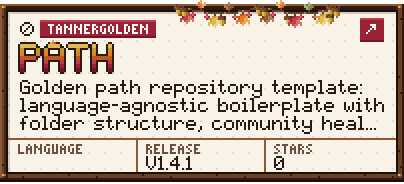
</picture>
</a>
<!-- markdown:element:path:end -->
<!-- markdown:element:standards:start -->
<a href="https://github.com/tannergolden/standards">
<picture>
  <source media="(prefers-color-scheme: dark)" srcset="assets/elements/standards-dark.svg">
  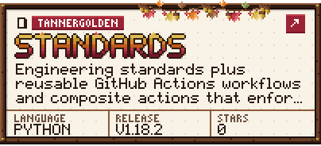
</picture>
</a>
<!-- markdown:element:standards:end -->

<!-- markdown:element:intelligence:start -->
<a href="https://github.com/tannergolden/intelligence">
<picture>
  <source media="(prefers-color-scheme: dark)" srcset="assets/elements/intelligence-dark.svg">
  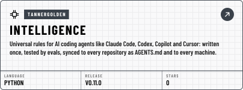
</picture>
</a>
<!-- markdown:element:intelligence:end -->
<!-- markdown:element:markdown:start -->
<a href="https://github.com/tannergolden/markdown">
<picture>
  <source media="(prefers-color-scheme: dark)" srcset="assets/elements/markdown-dark.svg">
  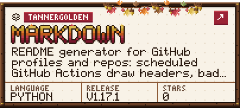
</picture>
</a>
<!-- markdown:element:markdown:end -->

</div>

### 🧰 Maintaining This Template

- **Every change gets a line in [`CHANGELOG.md`](CHANGELOG.md)**, under
  **Unreleased**, in the same pull request: it is what an owner reads before a
  sync.
- **A new file needs a line in `.github/template-sync`**, in the section that
  says what a generated repository does with it
  ([For Template Authors](https://github.com/tannergolden/standards/blob/Development/docs/distribution/automation/Template-Sync.md#-for-template-authors)).
- **Only the first half of [`docs/Prompts.md`](docs/Prompts.md) is the
  template's.** The rest is each owner's, and the validator holds it to a hash.
- **A merge reaches existing repositories only through a release.** Dispatch
  🏷️ Cut Release from the default branch with the next `vX.Y.Z` and
  `move-major` on. A breaking change ships as `v2`, which no repository follows
  until its owner moves `ref:`.

---

## 📦 What's Inside

<!-- AUTO-INDEX:BEGIN dir=. style=log -->

| Entry                                              | Purpose                                                                                                                                |
| :------------------------------------------------- | :------------------------------------------------------------------------------------------------------------------------------------- |
| [`.devcontainer/`](.devcontainer/README.md)        | The language-neutral development container this repository ships, and how to give it the toolchain your project needs.                 |
| [`.github/`](.github/)                             | Community health files, forms, CODEOWNERS, Dependabot, actions, scripts and workflows - logged below                                   |
| [`assets/`](assets/README.md)                      | Where this project keeps what presents it: four folders to start, a name ready for every other kind, and the rules every file follows. |
| [`benchmarks/`](benchmarks/README.md)              | The benchmark suites and recorded results that defend the performance budgets of this project.                                         |
| [`docs/`](docs/README.md)                          | Where this project keeps its own documents, and where the engineering standards it follows actually live.                              |
| [`examples/`](examples/README.md)                  | Runnable examples that show how to use this project, one per task, built and checked with the code they show.                          |
| [`packages/`](packages/README.md)                  | Workspace packages, one folder each, for when a second consumer needs shared code.                                                     |
| [`src/`](src/README.md)                            | The application source, split into three layers whose dependencies point inward.                                                       |
| [`tests/`](tests/README.md)                        | The test suites, from isolated units to whole user journeys, and how CI comes to run them.                                             |
| [`.editorconfig`](.editorconfig)                   | Editor defaults every editor honours: UTF-8, LF, a final newline, and indentation per language                                         |
| [`.env.example`](.env.example)                     | Environment variable template for this project.                                                                                        |
| [`.git-blame-ignore-revs`](.git-blame-ignore-revs) | Commits that changed only formatting, which `git blame` should look through.                                                           |
| [`.gitattributes`](.gitattributes)                 | Git attributes - line endings, diffs, and what counts as binary                                                                        |
| [`.gitignore`](.gitignore)                         | &#x1F5C4;&#xFE0F; Universal Ignore Patterns                                                                                            |
| [`.markdownlint.json`](.markdownlint.json)         | Repository-wide markdownlint rules. Discovered by mechanism, which is why this lives at the root.                                      |
| [`AGENTS.md`](AGENTS.md)                           | How AI coding agents work in this repository: the universal rules first, then its own.                                                 |
| [`CHANGELOG.md`](CHANGELOG.md)                     | What changed in each release of this template, newest first, so an owner can see what a Template Sync will bring before running it.    |
| [`LICENSE`](LICENSE)                               | MIT License                                                                                                                            |
| [`README.md`](README.md)                           | This file.                                                                                                                             |

<!-- AUTO-INDEX:END -->

Every folder carries a `README.md` that logs each file inside it. GitHub shows
a README in `.github/` in place of this page, so that folder's own files are
logged here instead. 🗂️ Machined Indexes redraws both tables after every push:

<!-- AUTO-INDEX:BEGIN dir=./.github style=log -->

| Entry                                                           | Purpose                                                                                                                                              |
| :-------------------------------------------------------------- | :--------------------------------------------------------------------------------------------------------------------------------------------------- |
| [`actions/`](.github/actions/README.md)                         | The composite actions this repository keeps for its own workflows, and for any other repository that calls them.                                     |
| [`DISCUSSION_TEMPLATE/`](.github/DISCUSSION_TEMPLATE/README.md) | The discussion category forms, each bound by its file name to the category it shapes.                                                                |
| [`ISSUE_TEMPLATE/`](.github/ISSUE_TEMPLATE/README.md)           | The issue forms a reporter chooses from, and the chooser configuration that offers them.                                                             |
| [`scripts/`](.github/scripts/README.md)                         | The checks this repository runs on its own configuration, and the tests that guard them.                                                             |
| [`workflows/`](.github/workflows/README.md)                     | Every workflow in this repository: the name it shows in the Actions tab, what triggers it, and what it does.                                         |
| [`ACCESSIBILITY.md`](.github/ACCESSIBILITY.md)                  | The accessibility this project aims for, how to report a barrier, and what happens after you do.                                                     |
| [`CODE_OF_CONDUCT.md`](.github/CODE_OF_CONDUCT.md)              | The code of conduct governing participation in this project, how to report a violation, and how harm is addressed and repaired.                      |
| [`CODEOWNERS`](.github/CODEOWNERS)                              | Folder-based ownership rules                                                                                                                         |
| [`commit-template.txt`](.github/commit-template.txt)            | &lt;type&gt;(&lt;scope&gt;): &lt;emoji&gt; &lt;subject starting lowercase, no em dash&gt;                                                            |
| [`CONTRIBUTING.md`](.github/CONTRIBUTING.md)                    | How to contribute, covering branching, commits, code style, testing, and the pull-request process.                                                   |
| [`dependabot.yml`](.github/dependabot.yml)                      | Dependabot - automated dependency updates                                                                                                            |
| [`FUNDING.yml`](.github/FUNDING.yml)                            | &#x1F496; Funding Options                                                                                                                            |
| [`GOVERNANCE.md`](.github/GOVERNANCE.md)                        | How this project is led, who decides what, how access continues, and the review and security standards every change meets.                           |
| [`markdown.lock.json`](.github/markdown.lock.json)              | -                                                                                                                                                    |
| [`markdown.md`](.github/markdown.md)                            | How the Markdown Kit draws this README, and how to change its theme, holidays, words, placards and trophies. Read it before editing its settings.    |
| [`markdown.yaml`](.github/markdown.yaml)                        | How &#x1F4DD; Markdown draws this README: its theme, the words on its header and footer, its placards and its trophy case.                           |
| [`pull_request_template.md`](.github/pull_request_template.md)  | This template becomes the body of your pull request.                                                                                                 |
| [`release.yml`](.github/release.yml)                            | GitHub auto-generated release notes configuration.                                                                                                   |
| [`SECURITY.md`](.github/SECURITY.md)                            | How to report a vulnerability privately, what happens after you do, which versions receive security fixes, and the protections this repository runs. |
| [`SUPPORT.md`](.github/SUPPORT.md)                              | Where to get help with this repository - the right channel for every kind of question.                                                               |
| [`template-sync`](.github/template-sync)                        | Every path tannergolden/path ships, and whether &#x1F504; Template Sync, when you run it, keeps it current in this repository.                       |
| [`template-sync.md`](.github/template-sync.md)                  | How this repository takes its template's later fixes when you run &#x1F504; Template Sync, what you control, and what waits on you.                  |
| [`TEMPLATE_INIT`](.github/TEMPLATE_INIT)                        | This repository has not been initialised yet.                                                                                                        |
| [`VULNERABILITY_REPORT.yml`](.github/VULNERABILITY_REPORT.yml)  | Report a suspected vulnerability privately, so the maintainers can fix it before it is made public.                                                  |

<!-- AUTO-INDEX:END -->

---

## 🤝 Getting Involved

- **Questions**: [`SUPPORT.md`](/.github/SUPPORT.md) says where to ask.
- **A bug or an idea**: open an issue from one of the forms.
- **A change**: [`CONTRIBUTING.md`](/.github/CONTRIBUTING.md) explains how,
  every change follows the
  [standards](https://github.com/tannergolden/standards/blob/Development/docs/README.md)
  by link, and every contribution follows the
  [code of conduct](/.github/CODE_OF_CONDUCT.md).
- **Who decides**: [`GOVERNANCE.md`](/.github/GOVERNANCE.md) names the
  maintainers.

---

## 🛡️ Security

Report a vulnerability privately, never in an issue:
[`SECURITY.md`](/.github/SECURITY.md) says how, and how fast a fix follows.

---

## ⚖️ Licence

The Golden Path is released under the terms in [LICENSE](/LICENSE).

---

<!-- markdown:trophies:start -->
<p align="center">
  <picture><source media="(prefers-color-scheme: dark)" srcset="assets/trophies/level.svg"></picture>
  <picture><source media="(prefers-color-scheme: dark)" srcset="assets/trophies/next-up.svg"></picture>
</p>

<p align="center">
  <a href="https://github.com/tannergolden/markdown/blob/HEAD/docs/references/Catalogue.md#repository-stars"><picture><source media="(prefers-color-scheme: dark)" srcset="assets/trophies/stars.svg">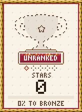</picture></a>
  <a href="https://github.com/tannergolden/markdown/blob/HEAD/docs/references/Catalogue.md#repository-forks"><picture><source media="(prefers-color-scheme: dark)" srcset="assets/trophies/forks.svg">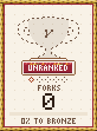</picture></a>
  <a href="https://github.com/tannergolden/markdown/blob/HEAD/docs/references/Catalogue.md#repository-contributors"><picture><source media="(prefers-color-scheme: dark)" srcset="assets/trophies/contributors.svg">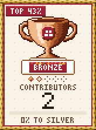</picture></a>
  <a href="https://github.com/tannergolden/markdown/blob/HEAD/docs/references/Catalogue.md#repository-commits"><picture><source media="(prefers-color-scheme: dark)" srcset="assets/trophies/commits.svg"></picture></a>
  <a href="https://github.com/tannergolden/markdown/blob/HEAD/docs/references/Catalogue.md#repository-releases"><picture><source media="(prefers-color-scheme: dark)" srcset="assets/trophies/releases.svg"></picture></a>
  <a href="https://github.com/tannergolden/markdown/blob/HEAD/docs/references/Catalogue.md#repository-merged"><picture><source media="(prefers-color-scheme: dark)" srcset="assets/trophies/merged.svg">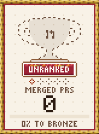</picture></a>
  <a href="https://github.com/tannergolden/markdown/blob/HEAD/docs/references/Catalogue.md#repository-resolved"><picture><source media="(prefers-color-scheme: dark)" srcset="assets/trophies/resolved.svg">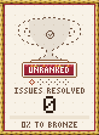</picture></a>
  <a href="https://github.com/tannergolden/markdown/blob/HEAD/docs/references/Catalogue.md#repository-active"><picture><source media="(prefers-color-scheme: dark)" srcset="assets/trophies/active.svg">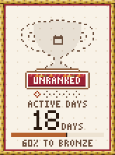</picture></a>
</p>

<details>
<summary><b>Achievements</b> · 28 of 100 earned · next: Active Days to Bronze, 60%</summary>

<p align="center"><b>Launch</b></p>
<p align="center">
  <a href="https://github.com/tannergolden/markdown/blob/HEAD/docs/references/Catalogue.md#repository-first-release"><picture><source media="(prefers-color-scheme: dark)" srcset="assets/trophies/achievements/first-release.svg"></picture></a>
  <a href="https://github.com/tannergolden/markdown/blob/HEAD/docs/references/Catalogue.md#repository-filed"><picture><source media="(prefers-color-scheme: dark)" srcset="assets/trophies/achievements/filed.svg">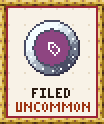</picture></a>
  <a href="https://github.com/tannergolden/markdown/blob/HEAD/docs/references/Catalogue.md#repository-first-tag"><picture><source media="(prefers-color-scheme: dark)" srcset="assets/trophies/achievements/first-tag.svg">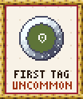</picture></a>
  <a href="https://github.com/tannergolden/markdown/blob/HEAD/docs/references/Catalogue.md#repository-named"><picture><source media="(prefers-color-scheme: dark)" srcset="assets/trophies/achievements/named.svg">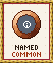</picture></a>
  <a href="https://github.com/tannergolden/markdown/blob/HEAD/docs/references/Catalogue.md#repository-first-fork"><picture><source media="(prefers-color-scheme: dark)" srcset="assets/trophies/achievements/first-fork.svg">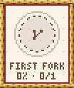</picture></a>
  <a href="https://github.com/tannergolden/markdown/blob/HEAD/docs/references/Catalogue.md#repository-first-merge"><picture><source media="(prefers-color-scheme: dark)" srcset="assets/trophies/achievements/first-merge.svg">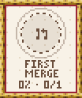</picture></a>
  <a href="https://github.com/tannergolden/markdown/blob/HEAD/docs/references/Catalogue.md#repository-first-star"><picture><source media="(prefers-color-scheme: dark)" srcset="assets/trophies/achievements/first-star.svg">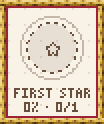</picture></a>
  <a href="https://github.com/tannergolden/markdown/blob/HEAD/docs/references/Catalogue.md#repository-first-watcher"><picture><source media="(prefers-color-scheme: dark)" srcset="assets/trophies/achievements/first-watcher.svg">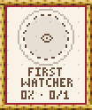</picture></a>
  <a href="https://github.com/tannergolden/markdown/blob/HEAD/docs/references/Catalogue.md#repository-front-door"><picture><source media="(prefers-color-scheme: dark)" srcset="assets/trophies/achievements/front-door.svg">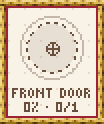</picture></a>
  <a href="https://github.com/tannergolden/markdown/blob/HEAD/docs/references/Catalogue.md#repository-outside-help"><picture><source media="(prefers-color-scheme: dark)" srcset="assets/trophies/achievements/outside-help.svg">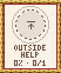</picture></a>
  <a href="https://github.com/tannergolden/markdown/blob/HEAD/docs/references/Catalogue.md#repository-poster"><picture><source media="(prefers-color-scheme: dark)" srcset="assets/trophies/achievements/poster.svg">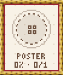</picture></a>
  <a href="https://github.com/tannergolden/markdown/blob/HEAD/docs/references/Catalogue.md#repository-stranger-report"><picture><source media="(prefers-color-scheme: dark)" srcset="assets/trophies/achievements/stranger-report.svg">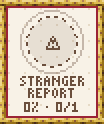</picture></a>
</p>

<p align="center"><b>Health</b></p>
<p align="center">
  <a href="https://github.com/tannergolden/markdown/blob/HEAD/docs/references/Catalogue.md#repository-gatekeeper"><picture><source media="(prefers-color-scheme: dark)" srcset="assets/trophies/achievements/gatekeeper.svg">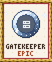</picture></a>
  <a href="https://github.com/tannergolden/markdown/blob/HEAD/docs/references/Catalogue.md#repository-locksmith"><picture><source media="(prefers-color-scheme: dark)" srcset="assets/trophies/achievements/locksmith.svg">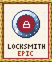</picture></a>
  <a href="https://github.com/tannergolden/markdown/blob/HEAD/docs/references/Catalogue.md#repository-paperwork"><picture><source media="(prefers-color-scheme: dark)" srcset="assets/trophies/achievements/paperwork.svg">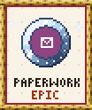</picture></a>
  <a href="https://github.com/tannergolden/markdown/blob/HEAD/docs/references/Catalogue.md#repository-support-line"><picture><source media="(prefers-color-scheme: dark)" srcset="assets/trophies/achievements/support-line.svg">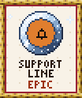</picture></a>
  <a href="https://github.com/tannergolden/markdown/blob/HEAD/docs/references/Catalogue.md#repository-auto-pilot"><picture><source media="(prefers-color-scheme: dark)" srcset="assets/trophies/achievements/auto-pilot.svg">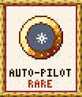</picture></a>
  <a href="https://github.com/tannergolden/markdown/blob/HEAD/docs/references/Catalogue.md#repository-changelog"><picture><source media="(prefers-color-scheme: dark)" srcset="assets/trophies/achievements/changelog.svg">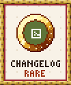</picture></a>
  <a href="https://github.com/tannergolden/markdown/blob/HEAD/docs/references/Catalogue.md#repository-form-filler"><picture><source media="(prefers-color-scheme: dark)" srcset="assets/trophies/achievements/form-filler.svg">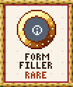</picture></a>
  <a href="https://github.com/tannergolden/markdown/blob/HEAD/docs/references/Catalogue.md#repository-house-rules"><picture><source media="(prefers-color-scheme: dark)" srcset="assets/trophies/achievements/house-rules.svg">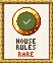</picture></a>
  <a href="https://github.com/tannergolden/markdown/blob/HEAD/docs/references/Catalogue.md#repository-welcome-mat"><picture><source media="(prefers-color-scheme: dark)" srcset="assets/trophies/achievements/welcome-mat.svg">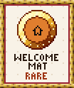</picture></a>
  <a href="https://github.com/tannergolden/markdown/blob/HEAD/docs/references/Catalogue.md#repository-well-formed"><picture><source media="(prefers-color-scheme: dark)" srcset="assets/trophies/achievements/well-formed.svg">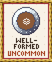</picture></a>
  <a href="https://github.com/tannergolden/markdown/blob/HEAD/docs/references/Catalogue.md#repository-clean-bill"><picture><source media="(prefers-color-scheme: dark)" srcset="assets/trophies/achievements/clean-bill.svg">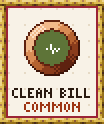</picture></a>
  <a href="https://github.com/tannergolden/markdown/blob/HEAD/docs/references/Catalogue.md#repository-documented"><picture><source media="(prefers-color-scheme: dark)" srcset="assets/trophies/achievements/documented.svg">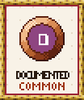</picture></a>
  <a href="https://github.com/tannergolden/markdown/blob/HEAD/docs/references/Catalogue.md#repository-licensed"><picture><source media="(prefers-color-scheme: dark)" srcset="assets/trophies/achievements/licensed.svg">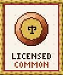</picture></a>
  <a href="https://github.com/tannergolden/markdown/blob/HEAD/docs/references/Catalogue.md#repository-label-maker"><picture><source media="(prefers-color-scheme: dark)" srcset="assets/trophies/achievements/label-maker.svg">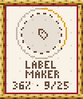</picture></a>
  <a href="https://github.com/tannergolden/markdown/blob/HEAD/docs/references/Catalogue.md#repository-open-hand"><picture><source media="(prefers-color-scheme: dark)" srcset="assets/trophies/achievements/open-hand.svg">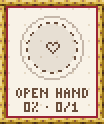</picture></a>
  <a href="https://github.com/tannergolden/markdown/blob/HEAD/docs/references/Catalogue.md#repository-protected"><picture><source media="(prefers-color-scheme: dark)" srcset="assets/trophies/achievements/protected.svg">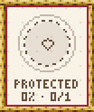</picture></a>
  <a href="https://github.com/tannergolden/markdown/blob/HEAD/docs/references/Catalogue.md#repository-roadmap"><picture><source media="(prefers-color-scheme: dark)" srcset="assets/trophies/achievements/roadmap.svg">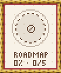</picture></a>
  <a href="https://github.com/tannergolden/markdown/blob/HEAD/docs/references/Catalogue.md#repository-town-hall"><picture><source media="(prefers-color-scheme: dark)" srcset="assets/trophies/achievements/town-hall.svg">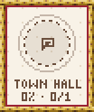</picture></a>
</p>

<p align="center"><b>Craft</b></p>
<p align="center">
  <a href="https://github.com/tannergolden/markdown/blob/HEAD/docs/references/Catalogue.md#repository-follows-the-standards"><picture><source media="(prefers-color-scheme: dark)" srcset="assets/trophies/achievements/follows-the-standards.svg">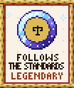</picture></a>
  <a href="https://github.com/tannergolden/markdown/blob/HEAD/docs/references/Catalogue.md#repository-golden-path"><picture><source media="(prefers-color-scheme: dark)" srcset="assets/trophies/achievements/golden-path.svg">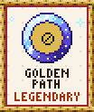</picture></a>
  <a href="https://github.com/tannergolden/markdown/blob/HEAD/docs/references/Catalogue.md#repository-ready-room"><picture><source media="(prefers-color-scheme: dark)" srcset="assets/trophies/achievements/ready-room.svg">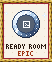</picture></a>
  <a href="https://github.com/tannergolden/markdown/blob/HEAD/docs/references/Catalogue.md#repository-by-the-book"><picture><source media="(prefers-color-scheme: dark)" srcset="assets/trophies/achievements/by-the-book.svg">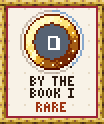</picture></a>
  <a href="https://github.com/tannergolden/markdown/blob/HEAD/docs/references/Catalogue.md#repository-signed"><picture><source media="(prefers-color-scheme: dark)" srcset="assets/trophies/achievements/signed.svg">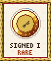</picture></a>
  <a href="https://github.com/tannergolden/markdown/blob/HEAD/docs/references/Catalogue.md#repository-small-steps"><picture><source media="(prefers-color-scheme: dark)" srcset="assets/trophies/achievements/small-steps.svg"></picture></a>
  <a href="https://github.com/tannergolden/markdown/blob/HEAD/docs/references/Catalogue.md#repository-test-suite"><picture><source media="(prefers-color-scheme: dark)" srcset="assets/trophies/achievements/test-suite.svg"></picture></a>
  <a href="https://github.com/tannergolden/markdown/blob/HEAD/docs/references/Catalogue.md#repository-wired"><picture><source media="(prefers-color-scheme: dark)" srcset="assets/trophies/achievements/wired.svg"></picture></a>
  <a href="https://github.com/tannergolden/markdown/blob/HEAD/docs/references/Catalogue.md#repository-squeaky"><picture><source media="(prefers-color-scheme: dark)" srcset="assets/trophies/achievements/squeaky.svg"></picture></a>
  <a href="https://github.com/tannergolden/markdown/blob/HEAD/docs/references/Catalogue.md#repository-green-machine"><picture><source media="(prefers-color-scheme: dark)" srcset="assets/trophies/achievements/green-machine.svg"></picture></a>
  <a href="https://github.com/tannergolden/markdown/blob/HEAD/docs/references/Catalogue.md#repository-release-notes"><picture><source media="(prefers-color-scheme: dark)" srcset="assets/trophies/achievements/release-notes.svg"></picture></a>
  <a href="https://github.com/tannergolden/markdown/blob/HEAD/docs/references/Catalogue.md#repository-semver"><picture><source media="(prefers-color-scheme: dark)" srcset="assets/trophies/achievements/semver.svg"></picture></a>
  <a href="https://github.com/tannergolden/markdown/blob/HEAD/docs/references/Catalogue.md#repository-containerized"><picture><source media="(prefers-color-scheme: dark)" srcset="assets/trophies/achievements/containerized.svg"></picture></a>
  <a href="https://github.com/tannergolden/markdown/blob/HEAD/docs/references/Catalogue.md#repository-gitmoji"><picture><source media="(prefers-color-scheme: dark)" srcset="assets/trophies/achievements/gitmoji.svg"></picture></a>
  <a href="https://github.com/tannergolden/markdown/blob/HEAD/docs/references/Catalogue.md#repository-packager"><picture><source media="(prefers-color-scheme: dark)" srcset="assets/trophies/achievements/packager.svg"></picture></a>
  <a href="https://github.com/tannergolden/markdown/blob/HEAD/docs/references/Catalogue.md#repository-prerelease"><picture><source media="(prefers-color-scheme: dark)" srcset="assets/trophies/achievements/prerelease.svg"></picture></a>
</p>

<p align="center"><b>Community</b></p>
<p align="center">
  <a href="https://github.com/tannergolden/markdown/blob/HEAD/docs/references/Catalogue.md#repository-regulars"><picture><source media="(prefers-color-scheme: dark)" srcset="assets/trophies/achievements/regulars.svg"></picture></a>
  <a href="https://github.com/tannergolden/markdown/blob/HEAD/docs/references/Catalogue.md#repository-crew"><picture><source media="(prefers-color-scheme: dark)" srcset="assets/trophies/achievements/crew.svg"></picture></a>
  <a href="https://github.com/tannergolden/markdown/blob/HEAD/docs/references/Catalogue.md#repository-ten-strong"><picture><source media="(prefers-color-scheme: dark)" srcset="assets/trophies/achievements/ten-strong.svg"></picture></a>
  <a href="https://github.com/tannergolden/markdown/blob/HEAD/docs/references/Catalogue.md#repository-answered"><picture><source media="(prefers-color-scheme: dark)" srcset="assets/trophies/achievements/answered.svg"></picture></a>
  <a href="https://github.com/tannergolden/markdown/blob/HEAD/docs/references/Catalogue.md#repository-fast-reply"><picture><source media="(prefers-color-scheme: dark)" srcset="assets/trophies/achievements/fast-reply.svg"></picture></a>
  <a href="https://github.com/tannergolden/markdown/blob/HEAD/docs/references/Catalogue.md#repository-good-first-issues"><picture><source media="(prefers-color-scheme: dark)" srcset="assets/trophies/achievements/good-first-issues.svg"></picture></a>
  <a href="https://github.com/tannergolden/markdown/blob/HEAD/docs/references/Catalogue.md#repository-help-wanted"><picture><source media="(prefers-color-scheme: dark)" srcset="assets/trophies/achievements/help-wanted.svg"></picture></a>
  <a href="https://github.com/tannergolden/markdown/blob/HEAD/docs/references/Catalogue.md#repository-long-thread"><picture><source media="(prefers-color-scheme: dark)" srcset="assets/trophies/achievements/long-thread.svg"></picture></a>
  <a href="https://github.com/tannergolden/markdown/blob/HEAD/docs/references/Catalogue.md#repository-mentor"><picture><source media="(prefers-color-scheme: dark)" srcset="assets/trophies/achievements/mentor.svg"></picture></a>
  <a href="https://github.com/tannergolden/markdown/blob/HEAD/docs/references/Catalogue.md#repository-org-backed"><picture><source media="(prefers-color-scheme: dark)" srcset="assets/trophies/achievements/org-backed.svg"></picture></a>
  <a href="https://github.com/tannergolden/markdown/blob/HEAD/docs/references/Catalogue.md#repository-outside-merges"><picture><source media="(prefers-color-scheme: dark)" srcset="assets/trophies/achievements/outside-merges.svg"></picture></a>
  <a href="https://github.com/tannergolden/markdown/blob/HEAD/docs/references/Catalogue.md#repository-popular-opinion"><picture><source media="(prefers-color-scheme: dark)" srcset="assets/trophies/achievements/popular-opinion.svg"></picture></a>
  <a href="https://github.com/tannergolden/markdown/blob/HEAD/docs/references/Catalogue.md#repository-reviewed"><picture><source media="(prefers-color-scheme: dark)" srcset="assets/trophies/achievements/reviewed.svg"></picture></a>
  <a href="https://github.com/tannergolden/markdown/blob/HEAD/docs/references/Catalogue.md#repository-talkative"><picture><source media="(prefers-color-scheme: dark)" srcset="assets/trophies/achievements/talkative.svg"></picture></a>
  <a href="https://github.com/tannergolden/markdown/blob/HEAD/docs/references/Catalogue.md#repository-triage"><picture><source media="(prefers-color-scheme: dark)" srcset="assets/trophies/achievements/triage.svg"></picture></a>
  <a href="https://github.com/tannergolden/markdown/blob/HEAD/docs/references/Catalogue.md#repository-well-maintained"><picture><source media="(prefers-color-scheme: dark)" srcset="assets/trophies/achievements/well-maintained.svg"></picture></a>
</p>

<p align="center"><b>Reach</b></p>
<p align="center">
  <a href="https://github.com/tannergolden/markdown/blob/HEAD/docs/references/Catalogue.md#repository-big-name"><picture><source media="(prefers-color-scheme: dark)" srcset="assets/trophies/achievements/big-name.svg"></picture></a>
  <a href="https://github.com/tannergolden/markdown/blob/HEAD/docs/references/Catalogue.md#repository-cloned"><picture><source media="(prefers-color-scheme: dark)" srcset="assets/trophies/achievements/cloned.svg"></picture></a>
  <a href="https://github.com/tannergolden/markdown/blob/HEAD/docs/references/Catalogue.md#repository-downloaded"><picture><source media="(prefers-color-scheme: dark)" srcset="assets/trophies/achievements/downloaded.svg"></picture></a>
  <a href="https://github.com/tannergolden/markdown/blob/HEAD/docs/references/Catalogue.md#repository-fork-magnet"><picture><source media="(prefers-color-scheme: dark)" srcset="assets/trophies/achievements/fork-magnet.svg"></picture></a>
  <a href="https://github.com/tannergolden/markdown/blob/HEAD/docs/references/Catalogue.md#repository-forked-far"><picture><source media="(prefers-color-scheme: dark)" srcset="assets/trophies/achievements/forked-far.svg"></picture></a>
  <a href="https://github.com/tannergolden/markdown/blob/HEAD/docs/references/Catalogue.md#repository-living-forks"><picture><source media="(prefers-color-scheme: dark)" srcset="assets/trophies/achievements/living-forks.svg"></picture></a>
  <a href="https://github.com/tannergolden/markdown/blob/HEAD/docs/references/Catalogue.md#repository-referred"><picture><source media="(prefers-color-scheme: dark)" srcset="assets/trophies/achievements/referred.svg"></picture></a>
  <a href="https://github.com/tannergolden/markdown/blob/HEAD/docs/references/Catalogue.md#repository-registry"><picture><source media="(prefers-color-scheme: dark)" srcset="assets/trophies/achievements/registry.svg"></picture></a>
  <a href="https://github.com/tannergolden/markdown/blob/HEAD/docs/references/Catalogue.md#repository-star-of-the-week"><picture><source media="(prefers-color-scheme: dark)" srcset="assets/trophies/achievements/star-of-the-week.svg"></picture></a>
  <a href="https://github.com/tannergolden/markdown/blob/HEAD/docs/references/Catalogue.md#repository-stargazer-streak"><picture><source media="(prefers-color-scheme: dark)" srcset="assets/trophies/achievements/stargazer-streak.svg"></picture></a>
  <a href="https://github.com/tannergolden/markdown/blob/HEAD/docs/references/Catalogue.md#repository-trending"><picture><source media="(prefers-color-scheme: dark)" srcset="assets/trophies/achievements/trending.svg"></picture></a>
  <a href="https://github.com/tannergolden/markdown/blob/HEAD/docs/references/Catalogue.md#repository-used-by"><picture><source media="(prefers-color-scheme: dark)" srcset="assets/trophies/achievements/used-by.svg"></picture></a>
  <a href="https://github.com/tannergolden/markdown/blob/HEAD/docs/references/Catalogue.md#repository-visited"><picture><source media="(prefers-color-scheme: dark)" srcset="assets/trophies/achievements/visited.svg"></picture></a>
  <a href="https://github.com/tannergolden/markdown/blob/HEAD/docs/references/Catalogue.md#repository-watched"><picture><source media="(prefers-color-scheme: dark)" srcset="assets/trophies/achievements/watched.svg"></picture></a>
</p>

<p align="center"><b>Rhythm</b></p>
<p align="center">
  <a href="https://github.com/tannergolden/markdown/blob/HEAD/docs/references/Catalogue.md#repository-night-shift"><picture><source media="(prefers-color-scheme: dark)" srcset="assets/trophies/achievements/night-shift.svg"></picture></a>
  <a href="https://github.com/tannergolden/markdown/blob/HEAD/docs/references/Catalogue.md#repository-alive"><picture><source media="(prefers-color-scheme: dark)" srcset="assets/trophies/achievements/alive.svg"></picture></a>
  <a href="https://github.com/tannergolden/markdown/blob/HEAD/docs/references/Catalogue.md#repository-long-game"><picture><source media="(prefers-color-scheme: dark)" srcset="assets/trophies/achievements/long-game.svg"></picture></a>
  <a href="https://github.com/tannergolden/markdown/blob/HEAD/docs/references/Catalogue.md#repository-weekend-project"><picture><source media="(prefers-color-scheme: dark)" srcset="assets/trophies/achievements/weekend-project.svg"></picture></a>
  <a href="https://github.com/tannergolden/markdown/blob/HEAD/docs/references/Catalogue.md#repository-streak"><picture><source media="(prefers-color-scheme: dark)" srcset="assets/trophies/achievements/streak.svg"></picture></a>
  <a href="https://github.com/tannergolden/markdown/blob/HEAD/docs/references/Catalogue.md#repository-monthly-release"><picture><source media="(prefers-color-scheme: dark)" srcset="assets/trophies/achievements/monthly-release.svg"></picture></a>
  <a href="https://github.com/tannergolden/markdown/blob/HEAD/docs/references/Catalogue.md#repository-weekly-beat"><picture><source media="(prefers-color-scheme: dark)" srcset="assets/trophies/achievements/weekly-beat.svg"></picture></a>
  <a href="https://github.com/tannergolden/markdown/blob/HEAD/docs/references/Catalogue.md#repository-big-week"><picture><source media="(prefers-color-scheme: dark)" srcset="assets/trophies/achievements/big-week.svg"></picture></a>
  <a href="https://github.com/tannergolden/markdown/blob/HEAD/docs/references/Catalogue.md#repository-marathon-day"><picture><source media="(prefers-color-scheme: dark)" srcset="assets/trophies/achievements/marathon-day.svg"></picture></a>
  <a href="https://github.com/tannergolden/markdown/blob/HEAD/docs/references/Catalogue.md#repository-comeback"><picture><source media="(prefers-color-scheme: dark)" srcset="assets/trophies/achievements/comeback.svg"></picture></a>
  <a href="https://github.com/tannergolden/markdown/blob/HEAD/docs/references/Catalogue.md#repository-friday-deploy"><picture><source media="(prefers-color-scheme: dark)" srcset="assets/trophies/achievements/friday-deploy.svg"></picture></a>
  <a href="https://github.com/tannergolden/markdown/blob/HEAD/docs/references/Catalogue.md#repository-same-day-fix"><picture><source media="(prefers-color-scheme: dark)" srcset="assets/trophies/achievements/same-day-fix.svg"></picture></a>
</p>

<p align="center"><b>Secret</b></p>
<p align="center">
  <a href="https://github.com/tannergolden/markdown/blob/HEAD/docs/references/Catalogue.md#repository-birthday"><picture><source media="(prefers-color-scheme: dark)" srcset="assets/trophies/achievements/birthday.svg"></picture></a>
  <a href="https://github.com/tannergolden/markdown/blob/HEAD/docs/references/Catalogue.md#repository-constellation"><picture><source media="(prefers-color-scheme: dark)" srcset="assets/trophies/achievements/constellation.svg"></picture></a>
  <a href="https://github.com/tannergolden/markdown/blob/HEAD/docs/references/Catalogue.md#repository-friday-the-13th"><picture><source media="(prefers-color-scheme: dark)" srcset="assets/trophies/achievements/friday-the-13th.svg"></picture></a>
  <a href="https://github.com/tannergolden/markdown/blob/HEAD/docs/references/Catalogue.md#repository-full-house"><picture><source media="(prefers-color-scheme: dark)" srcset="assets/trophies/achievements/full-house.svg"></picture></a>
  <a href="https://github.com/tannergolden/markdown/blob/HEAD/docs/references/Catalogue.md#repository-ghost"><picture><source media="(prefers-color-scheme: dark)" srcset="assets/trophies/achievements/ghost.svg"></picture></a>
  <a href="https://github.com/tannergolden/markdown/blob/HEAD/docs/references/Catalogue.md#repository-green-wall"><picture><source media="(prefers-color-scheme: dark)" srcset="assets/trophies/achievements/green-wall.svg"></picture></a>
  <a href="https://github.com/tannergolden/markdown/blob/HEAD/docs/references/Catalogue.md#repository-leap-day"><picture><source media="(prefers-color-scheme: dark)" srcset="assets/trophies/achievements/leap-day.svg"></picture></a>
  <a href="https://github.com/tannergolden/markdown/blob/HEAD/docs/references/Catalogue.md#repository-midnight-oil"><picture><source media="(prefers-color-scheme: dark)" srcset="assets/trophies/achievements/midnight-oil.svg"></picture></a>
  <a href="https://github.com/tannergolden/markdown/blob/HEAD/docs/references/Catalogue.md#repository-new-year"><picture><source media="(prefers-color-scheme: dark)" srcset="assets/trophies/achievements/new-year.svg"></picture></a>
  <a href="https://github.com/tannergolden/markdown/blob/HEAD/docs/references/Catalogue.md#repository-palindrome"><picture><source media="(prefers-color-scheme: dark)" srcset="assets/trophies/achievements/palindrome.svg"></picture></a>
  <a href="https://github.com/tannergolden/markdown/blob/HEAD/docs/references/Catalogue.md#repository-round-number"><picture><source media="(prefers-color-scheme: dark)" srcset="assets/trophies/achievements/round-number.svg"></picture></a>
  <a href="https://github.com/tannergolden/markdown/blob/HEAD/docs/references/Catalogue.md#repository-the-answer"><picture><source media="(prefers-color-scheme: dark)" srcset="assets/trophies/achievements/the-answer.svg"></picture></a>
</p>

</details>

<p align="center"><sub>Refreshed daily by <a href="https://github.com/tannergolden/markdown">tannergolden/markdown</a> · Every trophy and achievement, what it is for and how to earn it: <a href="https://github.com/tannergolden/markdown/blob/HEAD/docs/references/Catalogue.md#repository">the catalogue</a>. Click any card for its entry.</sub></p>
<!-- markdown:trophies:end -->

<!-- markdown:footer:start -->
<div align="center">

<a href="#top">
<picture>
  <source media="(max-width: 585px) and (prefers-color-scheme: dark)" srcset="assets/banners/footer-narrow-dark.svg">
  <source media="(max-width: 585px)" srcset="assets/banners/footer-narrow-day.svg">
  <source media="(prefers-color-scheme: dark)" srcset="assets/banners/footer-dark.svg">
  
</picture>
</a>

<a href="https://github.com/tannergolden/path/issues"><picture><source media="(prefers-color-scheme: dark)" srcset="assets/banners/link-issues-dark.svg"></picture></a>
<a href="https://github.com/tannergolden/path/pulls"><picture><source media="(prefers-color-scheme: dark)" srcset="assets/banners/link-pull-requests-dark.svg"></picture></a>
<a href="https://github.com/tannergolden/path/releases"><picture><source media="(prefers-color-scheme: dark)" srcset="assets/banners/link-releases-dark.svg"></picture></a>
<a href="https://github.com/tannergolden/path/actions"><picture><source media="(prefers-color-scheme: dark)" srcset="assets/banners/link-actions-dark.svg"></picture></a>

</div>
<!-- markdown:footer:end -->
