<!--
title: '🛤️ GOLDEN PATH'
description: 'A language-agnostic scaffold. Structure, community health files, and workflow triggers, with every standard followed by link rather than copied.'
type: index
-->

<!-- markdown:header:start -->
<!-- markdownlint-disable MD041 -->

<div align="center">

<a name="top"></a>

<picture>
  <source media="(max-width: 585px) and (prefers-color-scheme: dark)" srcset="assets/banners/header-narrow-dark.svg">
  <source media="(max-width: 585px)" srcset="assets/banners/header-narrow-day.svg">
  <source media="(prefers-reduced-motion: reduce) and (prefers-color-scheme: dark)" srcset="assets/banners/header-still-dark.svg">
  <source media="(prefers-reduced-motion: reduce)" srcset="assets/banners/header-still-day.svg">
  <source media="(prefers-color-scheme: dark)" srcset="assets/banners/header-dark.svg">
  
</picture>

</div>
<!-- markdown:header:end -->

---

## 💡 What This Is

A **golden path**: the paved, supported route to a new repository. It is a
**boilerplate** - a working starting shape, already decided - not an empty
directory with instructions.

That distinction is the whole design. Two things have to be true before a
repository is any good: it has to follow sound engineering standards, and it has
to have a structure. This template supplies **both**, and supplies them
differently on purpose.

|                   | How it arrives                                                                      | Why                                                                      |
| :---------------- | :---------------------------------------------------------------------------------- | :----------------------------------------------------------------------- |
| **The standards** | By link, from [`tannergolden/standards`](https://github.com/tannergolden/standards) | Shared, so a fix reaches every repository at once                        |
| **The structure** | Copied here, as real folders and files                                              | Yours from the first commit, because only you can decide what it becomes |

So you get `src/`, `tests/`, `packages/`, `benchmarks/`, `examples/`, `assets/`,
and `docs/` already laid out, community health files already written, and
continuous integration already wired - and none of it is enforced. A boilerplate
makes the common case free; it does not make the uncommon case impossible.

The name is the point. A golden path is not the only way to build something and
it is not compulsory. It is the way that already has the paving stones laid, so
taking it costs less than not taking it. Every file here is yours to change the
moment you have a reason to.

What it deliberately does **not** decide is the language: no build system, no
package manager, no toolchain. A structure is universal; a build is not.

**Nothing changes your tree on its own, and the scaffold can still keep up -
when you ask.** The standards stay current because they are linked. The files
copied here - the workflow stubs, the repository scripts, the seeded
documents - are brought up to date only when you run **🔄 Template Sync** from
the Actions tab: it proposes the template's later fixes as one pull request,
overwriting each of those files you left as it was and merging the ones you
changed. It never runs on its own, so a repository whose owner never runs it
never changes. Nothing is pushed to your branch, nothing you deleted comes
back, and editing anything after generating has no upstream consequence.
[`.github/template-sync`](.github/template-sync) names every file it may
touch: put a `#` in front of a line to keep that file yours. The structure
folders are on it switched off, so a sync never touches them unless you take
the `#` away. [How it works](.github/template-sync.md).

---

## 🧭 This Layout, Or Your Own

**This layout is meant to fit any project.** An app, a library, a service, a
command-line tool, a monorepo: each has code, tests, documents and the things
that present it, and each of those already has a folder here. So the default is
simple: **use this layout**, and fit your project into it. The
[Fit My Project Into This Scaffold](docs/Prompts.md#fit-my-project-into-this-scaffold)
prompt has an AI agent do the fitting.

**Keep a layout of your own only when your project needs one.** Some projects
already have a shape that means something, and moving them into `src/` would
break what they are:

| Your project                                                      | Why it keeps its own layout                                 |
| :---------------------------------------------------------------- | :---------------------------------------------------------- |
| Dotfiles, or anything else that mirrors where its files install   | The tree is the destination, so `src/` would mean nothing   |
| A notes vault or a knowledge base                                 | Its folders are its categories, and its readers browse them |
| A language, framework or build tool that sets a layout of its own | The tool finds files by where they are                      |

If you are not sure, use this one. A folder you do not need yet costs one
README; a layout you invent costs everyone who has to learn it.

**Either way, it is yours to customise.** Rename a folder, add one, or delete
one you will never use: every file here is yours to change, and the folder
READMEs say what each one is for, so you know what you are changing. A layout
of your own still keeps everything else this template ships - the checks, the
community health files, the development container and the editor settings -
because none of it cares where your code lives.

> [!WARNING]
> **🔄 Template Sync does overwrite some files.** Each time you run it, it
> brings every path in the **Kept current** section of
> [`.github/template-sync`](.github/template-sync) up to the template's latest
> release: the workflow stubs and scripts in `.github/`, the community health
> files and forms, `.devcontainer/`, the configuration files at the root, and
> the seeded documents and folder READMEs in `docs/`.
>
> - **A file you had not changed** is overwritten with the template's version.
> - **A file you changed** is merged with the template's change. Where you
>   both changed the same lines, yours stays as it is and the pull request
>   shows the template's change.
> - **A file the template removed** goes too, unless you had changed it.
>
> It still arrives as one pull request for you to review, and only when you
> run it. Your structure is not on that list: `src/`, `tests/`, `packages/`,
> `benchmarks/`, `examples/`, `assets/`, this README and the licence start
> switched off, and a file the template does not ship is never touched.
>
> So if you make one of those kept-current files your own - `docs/` put to a
> different use, say, or a `.gitignore` you rewrote - put a `#` in front of its
> line, or add a rule such as `!/docs/**` under **Your rules**, before you next
> run it. A file you delete is switched off for you. The
> [Get Ready For A Template Sync](docs/Prompts.md#get-ready-for-a-template-sync)
> prompt has an AI agent find those files, and dry-run the sync, first.

---

## 🔀 Fork, Or "Use This Template"

Both buttons hand you every file in this repository. They differ in exactly one
thing: whether your copy keeps a **link back to this one**.

**Fork it** when you want this repository's history, and to pull later changes
back down through git. A fork remembers where it came from, so `Sync fork` and
`git pull upstream` both work.

**Click "Use this template"** when you want the current version as a starting
point. You get a clean repository with a single `Initial commit` and no parent,
and later fixes to the scaffold can still reach it - whenever you run
**🔄 Template Sync**, as a pull request, one file at a time, merged with your
changes. It is the route this template is built for, and the one
**🚀 The First Five Minutes** assumes further down.

|                              | Fork                                              | "Use this template"                 |
| :--------------------------- | :------------------------------------------------ | :---------------------------------- |
| **Link back to here**        | Kept - `Sync fork` works                          | None                                |
| **Later scaffold fixes**     | `Sync fork`: every change, or none                | 🔄 Template Sync: per file, as a PR |
| **History**                  | Every commit this repository has                  | One `Initial commit`                |
| **Actions**                  | **Disabled until you enable them**, per GitHub    | On from the start                   |
| **Issues**                   | Off by default                                    | On                                  |
| **A new pull request**       | Defaults to targeting **this** repository         | Targets yours                       |
| **Visibility**               | Public, and a fork's visibility cannot be changed | Yours to choose                     |
| **Your contributions graph** | Commits to a fork do not count                    | They count                          |

### What a fork actually buys you

Less than it looks, and it is worth knowing why before choosing it. **The
standards reach both routes identically.** Every stub's `uses:` but
🔁 Intelligence Sync's and 📝 Markdown's points at `tannergolden/standards@v1`, a moving major
tag, so every fix in the v1 line arrives the moment it is published whether you
forked or generated - which is what **Staying current takes no effort**
describes further down.
Forking does not make you more current; that part is already free.

What a fork does sync is the **scaffold**: the nineteen workflows, the
directory layout, the seeded documents. A generated repository can take the
workflow and seed fixes too - every workflow but `cut-release.yml` and `markdown.yml`, while the
layout stays yours - whenever you run 🔄 Template Sync, so what a fork adds is the
shared history - and with it, every change at once or none. In a fork, delete
`.github/workflows/template-sync.yml`: `Sync fork` already carries the same
changes, and two routes to them would only collide.

> [!IMPORTANT]
> **Initialisation and `Sync fork` want opposite things.** Once Actions are
> running, the `init` job claims the repository - it rewrites the identity to
> your account and **force-pushes the default branch**. That force-push is the
> moment your history stops being a fast-forward of this one's, so `Sync fork`
> begins offering to discard your commits rather than catch you up.
>
> Neither is misbehaving: a fork wants a shared history, and initialisation
> deliberately rewrites one. If you want the fork **and** the shared history,
> delete `.github/TEMPLATE_INIT` before enabling Actions. That skips
> initialisation entirely, and the file itself lists what you then set by hand.

> [!TIP]
> **There is a third route.** Generate with "Use this template", then add this
> repository as a second remote:
>
> ```bash
> git remote add template https://github.com/tannergolden/path
> git fetch template
> ```
>
> Cherry-pick whatever you want from it, whenever you want it, with none of the
> fork's costs - no disabled Actions, no force-push collision, and no pull
> request that opens against somebody else's repository by mistake. For the
> template's own fixes, prefer 🔄 Template Sync: a cherry-pick arrives in the
> template author's identity, unmerged with your edits.

> [!NOTE]
> **Neither route carries the template flag over.** Some jobs read it: most
> of the jobs that act on a repository are silent in the golden path
> template, `release.yml` and initialisation are silent in every template,
> and 🏷️ Cut Release runs only in one. The checks, the Scorecard score, the
> run-history prune and the index redraw run on both sides. The table under
> **How The Workflows Work** says which is which, and 🔄 Template Sync reads
> the same flag to decide whether to check its list or to sync. A fork
> inherits that flag no more than a generated repository does, so your copy
> lands on the right side of every guard - and made a template of its own, it
> keeps its checks and still syncs from here.

---

## ⚠️ CI Is Green, And Only Half Configured

The `ci` job in `checks.yml` runs the commands **you** give it, and it **fails when every stage
resolves to nothing** rather than reporting a green check that checked nothing.
That leaves a new scaffold in an awkward spot: there is no source code to lint
yet, but "no source code" is not the same as "nothing to validate".

So `lint-command` starts out pointing at
[`.github/scripts/validate-repository.py`](.github/scripts/validate-repository.py),
which checks the files that exist from the first commit - every YAML and JSON
file parses, every workflow `uses:` is pinned to a tag or a commit rather than a
branch, no CRLF or stray whitespace, and every document's footer links its
licence from the repository root rather than naming it. A typo in any of those
breaks something quietly, so this is a real gate, not a placeholder that
returns zero. It also fails compiled code committed anywhere, which no reviewer
can read, and, once the repository is public, the vulnerability issue form,
which would publish a report the moment it was filed.

**It is still only half the story.** Nothing is testing or building your project,
because your project does not exist yet. Open `.github/workflows/checks.yml` and
replace that command once it does:

```yaml
jobs:
  ci:
    uses: tannergolden/standards/.github/workflows/ci.yml@v1
    with:
      lint-command: 'golangci-lint run'
      test-command: 'go test ./...'
      build-command: 'go build ./...'
```

Any language, any tool. A few starting points:

| Stack  | `lint-command`                      | `test-command`  | `build-command`         |
| :----- | :---------------------------------- | :-------------- | :---------------------- |
| Go     | `golangci-lint run`                 | `go test ./...` | `go build ./...`        |
| Rust   | `cargo clippy -- -D warnings`       | `cargo test`    | `cargo build --release` |
| Python | `ruff check .`                      | `pytest`        | `python -m build`       |
| Node   | `npm run lint`                      | `npm test`      | `npm run build`         |
| .NET   | `dotnet format --verify-no-changes` | `dotnet test`   | `dotnet build`          |

You do not have to fill in all of them - one real command is enough.

> [!TIP]
> Prefer a `Makefile`? Add one with `setup`, `lint`, `test` and `build` targets,
> then delete the `with:` block entirely: the `ci` job falls back to `make <target>`
> whenever no explicit command is given.

---

## 🤖 Agent Rules

This template ships **one `AGENTS.md`, written by the same sync every
repository takes, and the stub that keeps it current**.

Agent instructions are **always loaded**. Every byte is paid on every session, in
every repository, forever, and most of what they say belongs to a project rather
than to a scaffold: how you write commits, what must never be touched by hand,
which commands actually build the thing. So the file holds the universal rules,
empty sections for your own, and one section the template keeps because every
repository built from it needs it: **Research**, which says where research
reports go and that every research request ends in one.

| It ships                                                                             | What it does                                                                                                                                                                                                                                                                                                 |
| :----------------------------------------------------------------------------------- | :----------------------------------------------------------------------------------------------------------------------------------------------------------------------------------------------------------------------------------------------------------------------------------------------------------- |
| [`AGENTS.md`](AGENTS.md)                                                             | The universal rules between the `INTELLIGENCE` markers, which 🔁 Intelligence Sync keeps current; empty sections for your own; and the template's own sections, **Research** and **Synced files**, between `TEMPLATE-SYNC` markers, which 🔄 Template Sync keeps current without touching a line around them |
| [`.github/workflows/intelligence-sync.yml`](.github/workflows/intelligence-sync.yml) | 🔁 Intelligence Sync. Every Monday, and whenever you run it, it proposes the latest release of [`tannergolden/intelligence`](https://github.com/tannergolden/intelligence) as one pull request. It runs in this template too, which is where this `AGENTS.md` came from                                      |
| [`docs/Prompts.md`](docs/Prompts.md)                                                 | Ready-made prompts in two sections kept apart: the Golden Path's own, kept current by 🔄 Template Sync, and this repository's, which only you write. The first 🔁 Intelligence Sync leaves this page as it is                                                                                                |

A repository generated before this template shipped an `AGENTS.md` keeps its
own: 🔄 Template Sync puts each of the template's sections into it, under the
heading it follows here, and changes nothing else in the file.

**Nothing lands until you merge it.** The stub runs here as it does in yours.
It opens its pull request with the repository's own
token, so **Allow GitHub Actions to create and approve pull requests** must be
on, which `apply-settings` in step 4 below sees to, and GitHub holds that pull
request's checks until you approve them, unless a `BOT_ACCESS_TOKEN` opens it
as you instead. The hub suits several repositories that share one set of rules,
for the same reason the workflows here are called rather than copied: the law
lives in one place, and a fix reaches every repository at the next release.

Beside the stub, the template carries **policy for people**: the
[contributing guide](.github/CONTRIBUTING.md#3-ai-assisted-contributions) says
how AI-assisted contributions are handled - you sign off, the AI is credited
with `Co-Authored-By`, and you say in the pull request what it drafted. That is
a rule about contributions, not an instruction any tool loads.

**Nothing here depends on it, either.** Initialisation, CI, the rulesets, the
release flow and every other workflow behave identically without it. If you
would rather write your rules by hand, delete the stub and the block and write
`AGENTS.md` yourself: 🔄 Template Sync switches a deleted stub off rather than
bringing it back, and a **Research** section you take out stays out.

> [!IMPORTANT]
> **Whichever route you take, confirm the tools you actually use load what you
> wrote.** Most now read a root `AGENTS.md`, but not in every case: Claude Code,
> for one, skips it beside a `CLAUDE.md` unless its settings say otherwise. The
> hub's loader probe checks this on your own machine. Instructions nothing loads
> are worse than none, because they look finished.

> [!TIP]
> **Either route stays reversible.** What you write by hand is yours to delete.
> What the hub delivers sits between two markers in one file and arrives
> through one stub, so removing it is deleting both, and a `no-intelligence`
> topic keeps the hub's `make sync` from bringing it back. To stop the template
> keeping its section, put a `#` in front of `/AGENTS.md` in
> `.github/template-sync`.

---

## 🎉 What Happens On Its Own

**"Use this template" substitutes nothing.** GitHub copies every file verbatim,
so a generated repository would otherwise carry the template author as its
licence holder, funding target, maintainer and README credit forever.

The `init` job in `lifecycle.yml` fixes that on its own, once. It rewrites the identity to
**your** account, rewrites the bare "Initial commit" into a proper Conventional
Commit describing the new repository, and then deletes `.github/TEMPLATE_INIT`,
which is what stops it ever running again. Anything else
[`.github/template-sync`](.github/template-sync) names under **Only ever in the
template** - a file that serves the template and nothing generated from it -
goes with it, and every folder log is redrawn to match. 🏷️ Cut Release is not
one of them: any repository released by tag can adopt it, so it stays, inert,
until you adopt it or delete it.

On a **public** repository it also deletes the 🛡️ Vulnerability Report issue
form. That form exists for private repositories, where issues are already
closed to the public; on a public one a vulnerability goes through private
vulnerability reporting, with `.github/VULNERABILITY_REPORT.yml` asking the same
questions in private.

Two things it deliberately leaves alone. The first is any reference to a
repository on the template's account - `tannergolden/standards`, whose shared
workflows every repository calls, the agent instruction publisher, and this
template itself - because each belongs to that account rather than yours, so it
is correct for everyone. The second is your email address, which GitHub keeps
private. Commits use the `noreply` form, which always routes to you and
publishes nothing.

> [!NOTE]
> GitHub does not reliably fire an event when a repository is created from a
> template. If nothing happens within a minute or two, dispatch **🎯 Standards
> Lifecycle** from the Actions tab - the `init` job inside it is what claims the
> repository. Running it twice is harmless: the marker file is what permits
> it, and it is only removed on success.

---

## 🚀 The First Five Minutes

> [!TIP]
> The steps by hand that every repository on the standards shares, signing
> and the admin token among them, are kept as one checklist in the standards:
> [🙋 What You Do By Hand](https://github.com/tannergolden/standards/blob/Development/docs/introduction/What-You-Do-By-Hand.md).
> The steps below are this template's own, and add what only it needs.

1. **Check that init ran** - `.github/TEMPLATE_INIT` should be gone and the
   `LICENSE` should carry your name and the current year. If not, dispatch
   **🎯 Standards Lifecycle** from the Actions tab.
2. **Sign your commits off, and switch on the hooks.** `git commit -s` adds the
   `Signed-off-by` trailer that the DCO check requires. Once branch protection
   is on, a commit without it blocks the merge. Then let git check each commit
   before it exists - the message, the sign-off, and the staged changes for
   secrets - with the hooks this repository ships:

   ```bash
   git config core.hooksPath .github/scripts/hooks
   ```

   The development container does this for you.

3. **Fit your project in, and configure the `ci` job in `checks.yml`.** The
   [Fit My Project Into This Scaffold](docs/Prompts.md#fit-my-project-into-this-scaffold)
   prompt has an AI agent move your project into the folders here and point the
   `ci` job at its commands. Or configure the job by hand, as above, once you have
   something to build. If your project needs a layout of its own, keep it, and
   switch off any kept-current file you put to another use - see
   **🧭 This Layout, Or Your Own** above.
4. **Apply the settings, then the protection** - run **🎯 Apply Standards**
   from the Actions tab. `apply-settings` writes the repository settings
   (squash-only merges, head branches deleted on merge, auto-merge, the
   security features); `apply-rulesets` writes branch protection.
   **Both ship switched OFF, and `dry-run` ships on.** Turning `dry-run` off
   on its own applies only the labels, on a green run that looks like it did
   everything - so tick the job you want as well. Do settings first: they are
   checkboxes, while a wrong ruleset blocks every merge. See the token note
   below before you do. On a public repository the settings also include the
   Actions event policy that keeps `governance.yml`'s pull request triage and
   first-time welcome running once GitHub's default policy blocks
   `pull_request_target`, on 2 December 2026 at the latest.
5. **Check the private channels reach you.** The settings switch on private
   vulnerability reporting, which puts **Report a vulnerability** on the
   Security tab; without `ADMIN_TOKEN`, switch it on under Settings → Advanced
   Security. A conduct report needs a private route too. On a public
   repository an organization owns, accept content reports under Settings →
   Moderation options → Reported content. A personal account has no such
   setting, and its content reports reach GitHub alone, so give each
   maintainer a private contact in the Maintainers table of
   `.github/GOVERNANCE.md`.
6. **Use your account's community health files, if you keep them.** When your
   account's public `.github` repository holds a code of conduct, a
   contributing guide, a security policy and the rest for every repository, the
   copies here hide them. The
   [Use My Account's Community Health Files](docs/Prompts.md#use-my-accounts-community-health-files)
   prompt has an AI agent ask which copies to remove, then remove them, so
   GitHub shows yours. `README.md` is never one of them: it stays, for you to replace
   below.
7. **Name the maintainers.** Initialisation puts you in the **Maintainers**
   table in `.github/GOVERNANCE.md`; add anyone else with merge or admin
   access, and a private address if reports should reach you outside GitHub.
   Then uncomment the rules you want in `.github/CODEOWNERS`, replacing
   `@your-org/your-team` with a real owner. A rule naming an owner without
   write access is a GitHub error, which is why every rule ships commented out,
   and once initialised the repository validator fails a rule left naming the
   placeholder.
8. **Enable ecosystems in `.github/dependabot.yml`** as you add manifests. Only
   the three this template ships are on - the workflows, the development
   container and the scripts' requirements - because they are the only ones
   guaranteed to apply.
9. **Add a `BOT_ACCESS_TOKEN` secret** so 🔄 Template Sync, whenever you run
   it, can update the workflow stubs too - the default token cannot write
   `.github/workflows/`, so without it those files wait in an issue instead.
   While you are there, put a `#` in front of anything in
   `.github/template-sync` you want to own outright.
10. **Choose your licence.** `LICENSE` arrives as MIT, in your name. If your
    project needs another licence, replace the file: every document's footer
    links to `LICENSE` rather than naming one, so nothing else needs editing,
    and the repository validator fails a footer that names one.
11. **Replace this README.** Everything above describes the template, not your
    project. Nothing rewrites it for you, because only you know what this
    repository is for, but
    [`docs/templates/Project-README.md`](docs/templates/Project-README.md)
    gives you the sections a project's front page needs: copy it over this
    file and fill it in, leaving out its masthead and footer: the kit's next
    run draws the header and the footer in their place, in the theme
    [`.github/markdown.md`](.github/markdown.md) says how to choose. What the
    workflow table and the token note above say outlives this file in
    [`.github/workflows/README.md`](.github/workflows/README.md), which logs
    every workflow and every secret they read.

> [!NOTE]
> **Going public later is a checklist of its own.** The whole history, every
> Actions log and the vulnerability issue form become public with the code,
> and some settings exist only on a public repository. The standards'
> [going-public checklist](https://github.com/tannergolden/standards/blob/Development/docs/introduction/What-You-Do-By-Hand.md#going-public)
> lists each step, and the repository validator fails a public repository
> that still carries the form, which is usually the first sign it is due.

> [!IMPORTANT]
> **🎯 Apply Standards needs a token for two of its three jobs.** Applying the
> label taxonomy needs nothing. **Writing the settings and the rulesets** each
> need a token with administration write as `ADMIN_TOKEN`. Without it, those
> jobs stop with a sentence naming the missing token instead of a bare `403`.
>
> A fine-grained token with **Administration: Read and write**, and
> **Contents: Read-only**, which a private repository needs, is all it needs.
> Step-by-step:
> [Creating the ADMIN_TOKEN](https://github.com/tannergolden/standards/blob/Development/docs/operations/Branch-Protection.md#-creating-the-admin_token).
> You can skip it entirely by applying the settings and rulesets yourself,
> where your own rights are already enough.

---

## 📦 What's Inside

<!-- AUTO-INDEX:BEGIN dir=. style=log -->

| Entry                                              | Purpose                                                                                                                                |
| :------------------------------------------------- | :------------------------------------------------------------------------------------------------------------------------------------- |
| [`.devcontainer/`](.devcontainer/README.md)        | The language-neutral development container this repository ships, and how to give it the toolchain your project needs.                 |
| [`.github/`](.github/)                             | Community health files, forms, CODEOWNERS, Dependabot, actions, scripts and workflows - logged below                                   |
| [`assets/`](assets/README.md)                      | Where this project keeps what presents it: four folders to start, a name ready for every other kind, and the rules every file follows. |
| [`benchmarks/`](benchmarks/README.md)              | The benchmark suites and recorded results that defend the performance budgets of this project.                                         |
| [`docs/`](docs/README.md)                          | Where this project keeps its own documents, and where the engineering standards it follows actually live.                              |
| [`examples/`](examples/README.md)                  | Runnable examples that show how to use this project, one per task, built and checked with the code they show.                          |
| [`packages/`](packages/README.md)                  | Workspace packages, one folder each, for when a second consumer needs shared code.                                                     |
| [`src/`](src/README.md)                            | The application source, split into three layers whose dependencies point inward.                                                       |
| [`tests/`](tests/README.md)                        | The test suites, from isolated units to whole user journeys, and how CI comes to run them.                                             |
| [`.editorconfig`](.editorconfig)                   | Editor defaults every editor honours: UTF-8, LF, a final newline, and indentation per language                                         |
| [`.env.example`](.env.example)                     | Environment variable template for this project.                                                                                        |
| [`.git-blame-ignore-revs`](.git-blame-ignore-revs) | Commits that changed only formatting, which `git blame` should look through.                                                           |
| [`.gitattributes`](.gitattributes)                 | Git attributes - line endings, diffs, and what counts as binary                                                                        |
| [`.gitignore`](.gitignore)                         | &#x1F5C4;&#xFE0F; Universal Ignore Patterns                                                                                            |
| [`.markdownlint.json`](.markdownlint.json)         | Repository-wide markdownlint rules. Discovered by mechanism, which is why this lives at the root.                                      |
| [`AGENTS.md`](AGENTS.md)                           | How AI coding agents work in this repository: the universal rules first, then its own.                                                 |
| [`CHANGELOG.md`](CHANGELOG.md)                     | What changed in each release of this template, newest first, so an owner can see what a Template Sync will bring before running it.    |
| [`LICENSE`](LICENSE)                               | MIT License                                                                                                                            |
| [`README.md`](README.md)                           | This file.                                                                                                                             |

<!-- AUTO-INDEX:END -->

The root carries only what a tool discovers there by mechanism.

**Every folder carries a `README.md` that logs each file inside it**, with one
exception. GitHub shows a README in `.github/` in place of this page, so that
folder's own files are logged here instead. 🗂️ Machined Indexes redraws both
tables after every push to the default branch:

<!-- AUTO-INDEX:BEGIN dir=./.github style=log -->

| Entry                                                           | Purpose                                                                                                                                              |
| :-------------------------------------------------------------- | :--------------------------------------------------------------------------------------------------------------------------------------------------- |
| [`actions/`](.github/actions/README.md)                         | The composite actions this repository keeps for its own workflows, and for any other repository that calls them.                                     |
| [`DISCUSSION_TEMPLATE/`](.github/DISCUSSION_TEMPLATE/README.md) | The discussion category forms, each bound by its file name to the category it shapes.                                                                |
| [`ISSUE_TEMPLATE/`](.github/ISSUE_TEMPLATE/README.md)           | The issue forms a reporter chooses from, and the chooser configuration that offers them.                                                             |
| [`scripts/`](.github/scripts/README.md)                         | The checks this repository runs on its own configuration, and the tests that guard them.                                                             |
| [`workflows/`](.github/workflows/README.md)                     | Every workflow in this repository: the name it shows in the Actions tab, what triggers it, and what it does.                                         |
| [`ACCESSIBILITY.md`](.github/ACCESSIBILITY.md)                  | The accessibility this project aims for, how to report a barrier, and what happens after you do.                                                     |
| [`CODE_OF_CONDUCT.md`](.github/CODE_OF_CONDUCT.md)              | The code of conduct governing participation in this project, how to report a violation, and how harm is addressed and repaired.                      |
| [`CODEOWNERS`](.github/CODEOWNERS)                              | Folder-based ownership rules                                                                                                                         |
| [`commit-template.txt`](.github/commit-template.txt)            | &lt;type&gt;(&lt;scope&gt;): &lt;emoji&gt; &lt;subject starting lowercase, no em dash&gt;                                                            |
| [`CONTRIBUTING.md`](.github/CONTRIBUTING.md)                    | How to contribute, covering branching, commits, code style, testing, and the pull-request process.                                                   |
| [`dependabot.yml`](.github/dependabot.yml)                      | Dependabot - automated dependency updates                                                                                                            |
| [`FUNDING.yml`](.github/FUNDING.yml)                            | &#x1F496; Funding Options                                                                                                                            |
| [`GOVERNANCE.md`](.github/GOVERNANCE.md)                        | How this project is led, who decides what, how access continues, and the review and security standards every change meets.                           |
| [`markdown.lock.json`](.github/markdown.lock.json)              | -                                                                                                                                                    |
| [`markdown.md`](.github/markdown.md)                            | How the Markdown Kit draws this README, and how to change its theme, holidays, words, placards and trophies. Read it before editing its settings.    |
| [`markdown.yaml`](.github/markdown.yaml)                        | How &#x1F4DD; Markdown draws this README: its theme, the words on its header and footer, its placards and its trophy case.                           |
| [`pull_request_template.md`](.github/pull_request_template.md)  | This template becomes the body of your pull request.                                                                                                 |
| [`release.yml`](.github/release.yml)                            | GitHub auto-generated release notes configuration.                                                                                                   |
| [`SECURITY.md`](.github/SECURITY.md)                            | How to report a vulnerability privately, what happens after you do, which versions receive security fixes, and the protections this repository runs. |
| [`SUPPORT.md`](.github/SUPPORT.md)                              | Where to get help with this repository - the right channel for every kind of question.                                                               |
| [`template-sync`](.github/template-sync)                        | Every path tannergolden/path ships, and whether &#x1F504; Template Sync, when you run it, keeps it current in this repository.                       |
| [`template-sync.md`](.github/template-sync.md)                  | How this repository takes its template's later fixes when you run &#x1F504; Template Sync, what you control, and what waits on you.                  |
| [`TEMPLATE_INIT`](.github/TEMPLATE_INIT)                        | This repository has not been initialised yet.                                                                                                        |
| [`VULNERABILITY_REPORT.yml`](.github/VULNERABILITY_REPORT.yml)  | Report a suspected vulnerability privately, so the maintainers can fix it before it is made public.                                                  |

<!-- AUTO-INDEX:END -->

---

## 🌿 How The Workflows Work

Your repository holds **triggers**. The logic lives in
[`tannergolden/standards`](https://github.com/tannergolden/standards), or for
🔁 Intelligence Sync in
[`tannergolden/intelligence`](https://github.com/tannergolden/intelligence), or
for 📝 Markdown in
[`tannergolden/markdown`](https://github.com/tannergolden/markdown), and
is pulled in by `uses:`. GitHub only runs a workflow that lives in the repository
being pushed to, which is why these small files exist here at all. They are
grouped by what they do - everything that verifies a change in one file,
everything that reacts to humans in another - so one push produces one run
with every check in it, not four runs to read separately. The pull request
check is the one exception, with `semantic-pr.yml` to itself: beside the
triage in `governance.yml` it was listed a second time, skipped, on every pull
request. Two of the nineteen, `verify-stubs.yml` and `scorecard.yml`, run steps
of their own instead of calling the standards.

| Workflow                   | Gives you                                                              | In the golden path template        |
| :------------------------- | :--------------------------------------------------------------------- | :--------------------------------- |
| `checks.yml`               | The gates: lint/test/build, secret scan, CodeQL, workflow lint         | Runs, as in yours                  |
| `semantic-pr.yml`          | The `pr` check: PR title, branch name, commit messages, DCO sign-off   | Runs, as in yours                  |
| `governance.yml`           | Onboarding, triage, stale sweep, slash commands                        | Silent                             |
| `release.yml`              | Draft notes, publish assets, registries, prune old releases on request | Silent in every template           |
| `maintenance.yml`          | Prunes stale deployments; deletes draft releases on request            | Silent                             |
| `prune-runs.yml`           | Prunes workflow run history, with its logs and artifacts               | Runs, as in yours                  |
| `lifecycle.yml`            | Claims this repository once; tells you when a new major exists         | Silent                             |
| `dependabot-automerge.yml` | Approves and queues Dependabot's patch and minor updates               | Silent                             |
| `ci-failure-alert.yml`     | Opens an issue when a watched workflow fails, closes it on green       | Silent                             |
| `apply-standards.yml`      | Dispatch-only. The label taxonomy, the settings and branch protection  | Silent                             |
| `auto-format.yml`          | Formats what a push touched                                            | Silent                             |
| `preview-deploy.yml`       | Deploys pushes to a preview target, once one is configured             | Silent                             |
| `verify-stubs.yml`         | Proves every job's permission ceiling matches its called workflow      | Runs, as in yours                  |
| `auto-index.yml`           | Redraws every folder log and index after a push, as a pull request     | Runs, as in yours                  |
| `scorecard.yml`            | A weekly OpenSSF Scorecard score, filed under code scanning            | Runs, as in yours                  |
| `template-sync.yml`        | Proposes the template's later fixes as one pull request, when run      | Checks its list instead of syncing |
| `intelligence-sync.yml`    | Proposes the shared agent rules as one pull request, every Monday      | Silent                             |
| `markdown.yml`             | Draws this README in its theme, every night. Seeded once, never synced | Runs, as in yours                  |
| `cut-release.yml`          | Publishes this template's releases. Inert in yours until you adopt it  | Runs only in a template            |

**Do not rename the job ids** `ci` and `secrets` (in `checks.yml`) or `pr`
(in `semantic-pr.yml`). A called workflow reports its checks as
`<job id> / <job name>`, so branch protection depends on them - the file a
job lives in does not matter, but its id does.

Every workflow ships installed. **The checks run everywhere, the golden path
template included**: what a template ships - the scripts, the workflows, the
seeded documents - is exactly what every generated repository's required
checks run against, so it is checked before it ships. **Most jobs that act on a
repository are silent in the golden path template** and come alive in every
repository generated from this one, even one you make a template of its own:
triage, the welcome, releases, settings and most housekeeping. The run-history
prune and the index redraw run in the template as well, which needs them as
much. `template-sync.yml` checks the
template's list instead of syncing there, and `cut-release.yml` runs only in a
template, publishing the releases your copy follows, until a repository
released by tag adopts it. Delete any file that does not fit your project -
each one is yours, and nothing reinstalls it: 🔄 Template Sync switches a
deleted file off rather than bringing it back.

> [!IMPORTANT]
> **The required checks report everywhere, and on a merge queue too.** `ci`,
> `secrets` and `pr` - the three job ids branch protection names - run in
> every repository, templates included, so applying the rulesets never leaves
> a pull request waiting on a check that cannot run. Each also triggers on
> `merge_group`, so the rulesets work with a merge queue. In a merge group the
> `pr` jobs and dependency review have no pull request to read, so they skip,
> and the secret scan passes without scanning again, because each commit in
> the group was scanned on its own pull request; GitHub counts a skipped job
> as passing. Never skip a required job in its stub, though: a job skipped
> there reports under its bare id, such as `secrets`, not the name branch
> protection waits for.

### Staying current takes no effort

`@v1` is a **moving major tag**. Every fix and feature in the v1 line reaches
this repository the moment it is published - no pull request, no update
command, nothing to maintain. Breaking changes never arrive that way, because a
new major is a different tag.

That leaves exactly one gap, and the `standards` job in `lifecycle.yml` fills
it: when `v2` is published it opens **one issue** telling you, and changes
nothing. Adopting a
major is a decision, not a chore.

The files copied here - the stubs themselves among them - cannot follow a tag.
They keep up a different way, and only when you ask: see
**🔄 Template Sync: Fixes When You Ask** below.

Almost nothing here pins a third-party action, either. Every `uses:` in the
stubs points at `tannergolden/standards`, or `tannergolden/intelligence` for
🔁 Intelligence Sync, or `tannergolden/markdown` for 📝 Markdown, so the SHA
pins behind them are maintained once, there,
rather than in every repository built from this one.
The exceptions are `verify-stubs.yml` and `scorecard.yml`, which run steps of
their own and pin each third-party action they use to a commit. Those pins are
why `.github/dependabot.yml` ships with `github-actions` enabled: it keeps them
current. It also keeps the development container's features and the
repository scripts' one Python requirement current, the other two manifests
every generated repository starts with.

> [!NOTE]
> **If this repository goes quiet for 60 days, GitHub disables its scheduled
> workflows.** That is a platform rule for public repositories, not something a
> workflow can opt out of, and it takes the weekly checks sweep, the governance
> sweep, the Scorecard score, and the new-major alarm in `lifecycle.yml` with
> it. GitHub emails you
> when it happens, and one commit or a manual dispatch turns them back on.
>
> The safety net is that **Dependabot is not subject to that rule**. It keeps
> reading `.github/dependabot.yml`, and because a moving major tag only changes
> when the major changes, a `v2` still arrives as a pull request even with
> every cron asleep. So a dormant repository still finds out; it just finds out
> through Dependabot instead of through an issue.
>
> Dependabot has a dormancy rule of its own, though: once one of its pull
> requests has been open for more than 90 days, and in that time nobody has
> merged or closed any of them, edited `.github/dependabot.yml` or run an
> update by hand, it pauses. It then opens no pull request at all, security
> updates included, until someone does. Merge or close what it opens, and the
> safety net holds.

If you would rather pin an exact version for an auditable record of what ran
when, pin its commit, as `@<sha> # v1.4.2`, not the version tag: the standards
delete each version's tag when the next is cut, and a stub pinned to a tag
that is gone stops running. Dependabot updates commit pins and their version
comments natively, and the `dependabot-automerge` stub will merge them on
green CI.

---

## 🔄 Template Sync: Fixes When You Ask

This template keeps improving after you generate from it - a stub gains a
guard, the repository validator learns a check, a seeded document gets
clearer. **🔄 Template Sync** is how those fixes reach your copy, and it runs
only when you run it.

**Nothing happens on its own.** There is no schedule. When you want the
template's latest release, run **🔄 Template Sync** from the Actions tab: it
compares this repository with that release and proposes whatever changed as
**one pull request** on `chore/template-sync`, which you review and merge like
any other. If you never run it, nothing in this repository ever changes. What
each release brings is in the template's
[changelog](https://github.com/tannergolden/path/blob/Development/CHANGELOG.md),
so you can read it before you run one.

**Every file a sync keeps current is listed in
[`docs/Synced-Files.md`](docs/Synced-Files.md)**, with the part of each that is
yours to change. Read it before you edit one: a file you only want current is
brought up to date by its sync, never by hand.

| It always...                        | Because                                                                                                                  |
| :---------------------------------- | :----------------------------------------------------------------------------------------------------------------------- |
| Overwrites only what you left alone | A file you had not changed takes the template's version; one you changed is merged, by the same three-way merge git uses |
| Writes in your identity             | The template is rewritten exactly as initialisation rewrote it, so footers and contact links stay yours                  |
| Leaves a conflict untouched         | A file you and the template changed in the same place stays as you have it; the pull request shows the change            |
| Respects a deletion                 | A file you delete is switched off, under its old name or a new one, until you take the `#` off its line again            |
| Leaves your structure alone         | `src/`, `tests/`, `packages/`, `benchmarks/`, `examples/`, `assets/`, this README and the licence start switched off     |

Three files describe it, and only one of them is yours to edit:

| File                                                   | What it is                                                                                                     |
| :----------------------------------------------------- | :------------------------------------------------------------------------------------------------------------- |
| [`.github/template-sync`](.github/template-sync)       | Every path the template ships, in `.gitignore` syntax. Put a `#` in front of a line to keep that file as yours |
| `.github/template-sync.lock`                           | Where each file was last synced from. Written by the sync alone; never edit it                                 |
| [`.github/template-sync.md`](.github/template-sync.md) | The full explanation: every outcome, every option, and what to do when something waits on you                  |

> [!IMPORTANT]
> **Workflow files need a `BOT_ACCESS_TOKEN`.** GitHub's default token cannot
> write anything under `.github/workflows/`, so without the secret those files
> wait - named in the pull request and in one issue, never dropped - while
> everything else arrives. With it, they arrive like any other file, and CI
> runs on the pull request.

**You follow a major, and a new one is your decision.** This template publishes
versions with 🏷️ Cut Release, moving `v1` to each new one, and a sync takes
whatever `v1` points at. A breaking change ships as `v2`, which nothing follows
until you change `ref:` in `.github/workflows/template-sync.yml`. To remove the
option altogether, delete that file.

The engine lives in [`tannergolden/standards`](https://github.com/tannergolden/standards/blob/Development/docs/distribution/automation/Template-Sync.md),
called rather than copied, like every other workflow here.

---

## 🎨 This Page Is Drawn

This README's header, cards, trophy case and footer are drawn by the
[Markdown Kit](https://github.com/tannergolden/markdown) every night, in the
`blackprint` with the holidays on, from the stub in
`.github/workflows/markdown.yml` and the settings in `.github/markdown.yaml`.
Your repository starts with both, seeded once: 🔄 Template Sync never touches
them, so the theme is yours to change whenever you like, and
[`.github/markdown.md`](.github/markdown.md) says how.

The cards are the four repositories every repository generated from this one
runs on: this template, whose fixes arrive by 🔄 Template Sync; the
standards, whose workflows the stubs call; the hub that writes the rules in
`AGENTS.md`; and the kit that draws this page.

<div align="center">

<!-- markdown:element:path:start -->
<a href="https://github.com/tannergolden/path">
<picture>
  <source media="(prefers-color-scheme: dark)" srcset="assets/elements/path-dark.svg">
  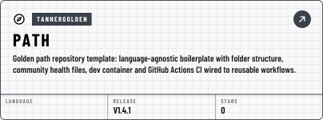
</picture>
</a>
<!-- markdown:element:path:end -->
<!-- markdown:element:standards:start -->
<a href="https://github.com/tannergolden/standards">
<picture>
  <source media="(prefers-color-scheme: dark)" srcset="assets/elements/standards-dark.svg">
  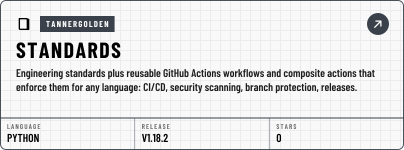
</picture>
</a>
<!-- markdown:element:standards:end -->

<!-- markdown:element:intelligence:start -->
<a href="https://github.com/tannergolden/intelligence">
<picture>
  <source media="(prefers-color-scheme: dark)" srcset="assets/elements/intelligence-dark.svg">
  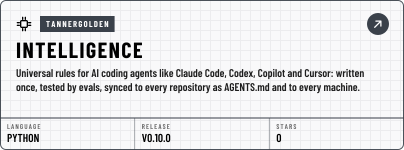
</picture>
</a>
<!-- markdown:element:intelligence:end -->
<!-- markdown:element:markdown:start -->
<a href="https://github.com/tannergolden/markdown">
<picture>
  <source media="(prefers-color-scheme: dark)" srcset="assets/elements/markdown-dark.svg">
  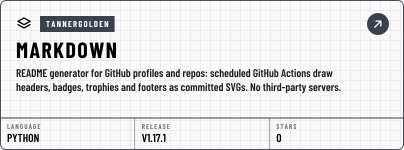
</picture>
</a>
<!-- markdown:element:markdown:end -->

</div>

---

## 🧰 Maintaining This Template

This section is for whoever changes the template itself, rather than a
repository generated from it.

**A pull request here runs the same checks as anywhere else.** 🚦 Checks
lints the configuration, runs the scripts' tests, enforces every document's
frontmatter, scans for secrets and runs CodeQL and the workflow lint; ✍️ the
`pr` check holds the title, the branch name, the commit messages and the
sign-off; 🔄 Template Sync holds `.github/template-sync` to the files this
template ships; and 🔬 Verify Stub Ceilings runs when a workflow, the checker
or its requirements changed. 🗂️ Machined Indexes
redraws the folder logs after the merge, as a pull request, and
🛡️ OpenSSF Scorecard rescores the default branch. 🎯 Apply Standards is silent
here: a dispatch applies nothing and still reports green.

The checks matter most for the seeds and the scripts: every generated
repository's required `ci` job runs them, with `frontmatter: 'enforce'`, so a
file that fails here would fail that check in each repository that syncs it.
To run the same gates before a push, from the root, with the standards cloned
beside this repository:

```bash
git clone --depth 1 --branch v1 https://github.com/tannergolden/standards ../standards

python3 -m pip install --require-hashes --requirement .github/scripts/requirements.txt
python3 .github/scripts/validate-repository.py
python3 -m unittest discover -s .github/scripts -p 'test_*.py'
python3 ../standards/.github/scripts/template-sync.py check --repo-dir .
python3 ../standards/.github/scripts/update-doc-indexes.py --check --tree
python3 ../standards/.github/scripts/check-frontmatter.py --mode enforce
```

**Every change gets a line in [`CHANGELOG.md`](CHANGELOG.md)**, under
**Unreleased**, in the same pull request. It is what an owner reads before
running 🔄 Template Sync, and it is the template's only lasting record of a
release: Cut Release prunes the page and the tag it supersedes, and
initialisation deletes the file from every generated repository.

**`docs/Prompts.md` is two sections, and the template writes only the
first.** Add or change a Golden Path prompt only between the two comments
that open and close its section. Never change anything from
**✍️ This Repository's Prompts** to the end of the page: that is each owner's,
and a change there would reach every generated repository's own prompts at its
next sync, and conflict with whatever its owner wrote. The repository validator
holds that half to a hash while `.github/TEMPLATE_INIT` exists, so 🏷️ Cut
Release refuses a release that changed it.

**🔁 Intelligence Sync is the hub's stub plus one guard.** When
`tannergolden/intelligence` changes `setup/intelligence-sync.yml`, bring the
change into `.github/workflows/intelligence-sync.yml` and keep the job's `if:`,
which keeps it silent in the golden path template.

**A new file needs a line in `.github/template-sync`**, in the section that
says what a generated repository does with it. The standards'
[For Template Authors](https://github.com/tannergolden/standards/blob/Development/docs/distribution/automation/Template-Sync.md#-for-template-authors)
sets out each section.

**A merge reaches existing repositories only through a release.** A
repository generated after it starts from it at once, because "Use this
template" copies the default branch, so merge a change that relies on a change
to the standards only once the standards have released it. The repositories
already generated follow `v1`, so dispatch 🏷️ Cut Release from the default
branch with the next `vX.Y.Z` and `move-major` left on. It refuses a version that is not a new
`vX.Y.Z` above the last one, a commit that is not on the default branch, a
tree missing `.github/template-sync` or `.github/workflows/template-sync.yml`,
and one the repository validator fails; otherwise it tags the version, moves
its major tag to it, publishes the release and prunes the one it superseded.
Before you dispatch it, move the **Unreleased** entries in `CHANGELOG.md` under
the new version, linked to its release page, and point the previous version's
link at the commit it was cut from: this release prunes that version's page
and tag.
A change that renames a file a generated repository depends on, or reshapes a
stub in a way a merge cannot carry, is breaking: release it as `v2`, which no
repository follows until its owner changes `ref:`.

**The guards know this template by name.** Each job that is silent only in
the golden path template names it by repository name in its `if:`, and so
does the standards' own Template Sync. Rename this repository and those jobs
start running in it.

---

## 📚 The Standards

Everything about how to branch, review, release, and secure a repository lives
in the [Standards Index](https://github.com/tannergolden/standards/blob/Development/docs/README.md).
Follow it **by link**. A standard copied into your repository is a standard that
starts going stale the moment you paste it.

The one exception is [`docs/templates/`](docs/templates/README.md), which is
meant to be copied: those are fill-in documents that become _your_ project's
decisions. A fill-in **standard** instantiates at its own path minus
`templates/`; the **work-product forms** - an ADR, a post-mortem, a user
story - go where a numbered or dated record belongs instead. The
[catalogue](docs/templates/README.md) gives each destination.

---

<!-- markdown:trophies:start -->
<p align="center">
  <picture><source media="(prefers-color-scheme: dark)" srcset="assets/trophies/level.svg"></picture>
  <picture><source media="(prefers-color-scheme: dark)" srcset="assets/trophies/next-up.svg"></picture>
</p>

<p align="center">
  <a href="https://github.com/tannergolden/markdown/blob/HEAD/docs/references/Catalogue.md#repository-stars"><picture><source media="(prefers-color-scheme: dark)" srcset="assets/trophies/stars.svg"></picture></a>
  <a href="https://github.com/tannergolden/markdown/blob/HEAD/docs/references/Catalogue.md#repository-forks"><picture><source media="(prefers-color-scheme: dark)" srcset="assets/trophies/forks.svg"></picture></a>
  <a href="https://github.com/tannergolden/markdown/blob/HEAD/docs/references/Catalogue.md#repository-contributors"><picture><source media="(prefers-color-scheme: dark)" srcset="assets/trophies/contributors.svg"></picture></a>
  <a href="https://github.com/tannergolden/markdown/blob/HEAD/docs/references/Catalogue.md#repository-commits"><picture><source media="(prefers-color-scheme: dark)" srcset="assets/trophies/commits.svg"></picture></a>
  <a href="https://github.com/tannergolden/markdown/blob/HEAD/docs/references/Catalogue.md#repository-releases"><picture><source media="(prefers-color-scheme: dark)" srcset="assets/trophies/releases.svg"></picture></a>
  <a href="https://github.com/tannergolden/markdown/blob/HEAD/docs/references/Catalogue.md#repository-merged"><picture><source media="(prefers-color-scheme: dark)" srcset="assets/trophies/merged.svg"></picture></a>
  <a href="https://github.com/tannergolden/markdown/blob/HEAD/docs/references/Catalogue.md#repository-resolved"><picture><source media="(prefers-color-scheme: dark)" srcset="assets/trophies/resolved.svg"></picture></a>
  <a href="https://github.com/tannergolden/markdown/blob/HEAD/docs/references/Catalogue.md#repository-active"><picture><source media="(prefers-color-scheme: dark)" srcset="assets/trophies/active.svg"></picture></a>
</p>

<details>
<summary><b>Achievements</b> · 28 of 100 earned · next: Active Days to Bronze, 60%</summary>

<p align="center"><b>Launch</b></p>
<p align="center">
  <a href="https://github.com/tannergolden/markdown/blob/HEAD/docs/references/Catalogue.md#repository-first-release"><picture><source media="(prefers-color-scheme: dark)" srcset="assets/trophies/achievements/first-release.svg"></picture></a>
  <a href="https://github.com/tannergolden/markdown/blob/HEAD/docs/references/Catalogue.md#repository-filed"><picture><source media="(prefers-color-scheme: dark)" srcset="assets/trophies/achievements/filed.svg"></picture></a>
  <a href="https://github.com/tannergolden/markdown/blob/HEAD/docs/references/Catalogue.md#repository-first-tag"><picture><source media="(prefers-color-scheme: dark)" srcset="assets/trophies/achievements/first-tag.svg"></picture></a>
  <a href="https://github.com/tannergolden/markdown/blob/HEAD/docs/references/Catalogue.md#repository-named"><picture><source media="(prefers-color-scheme: dark)" srcset="assets/trophies/achievements/named.svg"></picture></a>
  <a href="https://github.com/tannergolden/markdown/blob/HEAD/docs/references/Catalogue.md#repository-first-fork"><picture><source media="(prefers-color-scheme: dark)" srcset="assets/trophies/achievements/first-fork.svg"></picture></a>
  <a href="https://github.com/tannergolden/markdown/blob/HEAD/docs/references/Catalogue.md#repository-first-merge"><picture><source media="(prefers-color-scheme: dark)" srcset="assets/trophies/achievements/first-merge.svg"></picture></a>
  <a href="https://github.com/tannergolden/markdown/blob/HEAD/docs/references/Catalogue.md#repository-first-star"><picture><source media="(prefers-color-scheme: dark)" srcset="assets/trophies/achievements/first-star.svg"></picture></a>
  <a href="https://github.com/tannergolden/markdown/blob/HEAD/docs/references/Catalogue.md#repository-first-watcher"><picture><source media="(prefers-color-scheme: dark)" srcset="assets/trophies/achievements/first-watcher.svg"></picture></a>
  <a href="https://github.com/tannergolden/markdown/blob/HEAD/docs/references/Catalogue.md#repository-front-door"><picture><source media="(prefers-color-scheme: dark)" srcset="assets/trophies/achievements/front-door.svg"></picture></a>
  <a href="https://github.com/tannergolden/markdown/blob/HEAD/docs/references/Catalogue.md#repository-outside-help"><picture><source media="(prefers-color-scheme: dark)" srcset="assets/trophies/achievements/outside-help.svg"></picture></a>
  <a href="https://github.com/tannergolden/markdown/blob/HEAD/docs/references/Catalogue.md#repository-poster"><picture><source media="(prefers-color-scheme: dark)" srcset="assets/trophies/achievements/poster.svg"></picture></a>
  <a href="https://github.com/tannergolden/markdown/blob/HEAD/docs/references/Catalogue.md#repository-stranger-report"><picture><source media="(prefers-color-scheme: dark)" srcset="assets/trophies/achievements/stranger-report.svg"></picture></a>
</p>

<p align="center"><b>Health</b></p>
<p align="center">
  <a href="https://github.com/tannergolden/markdown/blob/HEAD/docs/references/Catalogue.md#repository-gatekeeper"><picture><source media="(prefers-color-scheme: dark)" srcset="assets/trophies/achievements/gatekeeper.svg"></picture></a>
  <a href="https://github.com/tannergolden/markdown/blob/HEAD/docs/references/Catalogue.md#repository-locksmith"><picture><source media="(prefers-color-scheme: dark)" srcset="assets/trophies/achievements/locksmith.svg"></picture></a>
  <a href="https://github.com/tannergolden/markdown/blob/HEAD/docs/references/Catalogue.md#repository-paperwork"><picture><source media="(prefers-color-scheme: dark)" srcset="assets/trophies/achievements/paperwork.svg"></picture></a>
  <a href="https://github.com/tannergolden/markdown/blob/HEAD/docs/references/Catalogue.md#repository-support-line"><picture><source media="(prefers-color-scheme: dark)" srcset="assets/trophies/achievements/support-line.svg"></picture></a>
  <a href="https://github.com/tannergolden/markdown/blob/HEAD/docs/references/Catalogue.md#repository-auto-pilot"><picture><source media="(prefers-color-scheme: dark)" srcset="assets/trophies/achievements/auto-pilot.svg"></picture></a>
  <a href="https://github.com/tannergolden/markdown/blob/HEAD/docs/references/Catalogue.md#repository-changelog"><picture><source media="(prefers-color-scheme: dark)" srcset="assets/trophies/achievements/changelog.svg"></picture></a>
  <a href="https://github.com/tannergolden/markdown/blob/HEAD/docs/references/Catalogue.md#repository-form-filler"><picture><source media="(prefers-color-scheme: dark)" srcset="assets/trophies/achievements/form-filler.svg"></picture></a>
  <a href="https://github.com/tannergolden/markdown/blob/HEAD/docs/references/Catalogue.md#repository-house-rules"><picture><source media="(prefers-color-scheme: dark)" srcset="assets/trophies/achievements/house-rules.svg"></picture></a>
  <a href="https://github.com/tannergolden/markdown/blob/HEAD/docs/references/Catalogue.md#repository-welcome-mat"><picture><source media="(prefers-color-scheme: dark)" srcset="assets/trophies/achievements/welcome-mat.svg"></picture></a>
  <a href="https://github.com/tannergolden/markdown/blob/HEAD/docs/references/Catalogue.md#repository-well-formed"><picture><source media="(prefers-color-scheme: dark)" srcset="assets/trophies/achievements/well-formed.svg"></picture></a>
  <a href="https://github.com/tannergolden/markdown/blob/HEAD/docs/references/Catalogue.md#repository-clean-bill"><picture><source media="(prefers-color-scheme: dark)" srcset="assets/trophies/achievements/clean-bill.svg"></picture></a>
  <a href="https://github.com/tannergolden/markdown/blob/HEAD/docs/references/Catalogue.md#repository-documented"><picture><source media="(prefers-color-scheme: dark)" srcset="assets/trophies/achievements/documented.svg"></picture></a>
  <a href="https://github.com/tannergolden/markdown/blob/HEAD/docs/references/Catalogue.md#repository-licensed"><picture><source media="(prefers-color-scheme: dark)" srcset="assets/trophies/achievements/licensed.svg"></picture></a>
  <a href="https://github.com/tannergolden/markdown/blob/HEAD/docs/references/Catalogue.md#repository-label-maker"><picture><source media="(prefers-color-scheme: dark)" srcset="assets/trophies/achievements/label-maker.svg"></picture></a>
  <a href="https://github.com/tannergolden/markdown/blob/HEAD/docs/references/Catalogue.md#repository-open-hand"><picture><source media="(prefers-color-scheme: dark)" srcset="assets/trophies/achievements/open-hand.svg"></picture></a>
  <a href="https://github.com/tannergolden/markdown/blob/HEAD/docs/references/Catalogue.md#repository-protected"><picture><source media="(prefers-color-scheme: dark)" srcset="assets/trophies/achievements/protected.svg"></picture></a>
  <a href="https://github.com/tannergolden/markdown/blob/HEAD/docs/references/Catalogue.md#repository-roadmap"><picture><source media="(prefers-color-scheme: dark)" srcset="assets/trophies/achievements/roadmap.svg"></picture></a>
  <a href="https://github.com/tannergolden/markdown/blob/HEAD/docs/references/Catalogue.md#repository-town-hall"><picture><source media="(prefers-color-scheme: dark)" srcset="assets/trophies/achievements/town-hall.svg"></picture></a>
</p>

<p align="center"><b>Craft</b></p>
<p align="center">
  <a href="https://github.com/tannergolden/markdown/blob/HEAD/docs/references/Catalogue.md#repository-follows-the-standards"><picture><source media="(prefers-color-scheme: dark)" srcset="assets/trophies/achievements/follows-the-standards.svg"></picture></a>
  <a href="https://github.com/tannergolden/markdown/blob/HEAD/docs/references/Catalogue.md#repository-golden-path"><picture><source media="(prefers-color-scheme: dark)" srcset="assets/trophies/achievements/golden-path.svg"></picture></a>
  <a href="https://github.com/tannergolden/markdown/blob/HEAD/docs/references/Catalogue.md#repository-ready-room"><picture><source media="(prefers-color-scheme: dark)" srcset="assets/trophies/achievements/ready-room.svg"></picture></a>
  <a href="https://github.com/tannergolden/markdown/blob/HEAD/docs/references/Catalogue.md#repository-by-the-book"><picture><source media="(prefers-color-scheme: dark)" srcset="assets/trophies/achievements/by-the-book.svg"></picture></a>
  <a href="https://github.com/tannergolden/markdown/blob/HEAD/docs/references/Catalogue.md#repository-signed"><picture><source media="(prefers-color-scheme: dark)" srcset="assets/trophies/achievements/signed.svg"></picture></a>
  <a href="https://github.com/tannergolden/markdown/blob/HEAD/docs/references/Catalogue.md#repository-small-steps"><picture><source media="(prefers-color-scheme: dark)" srcset="assets/trophies/achievements/small-steps.svg"></picture></a>
  <a href="https://github.com/tannergolden/markdown/blob/HEAD/docs/references/Catalogue.md#repository-test-suite"><picture><source media="(prefers-color-scheme: dark)" srcset="assets/trophies/achievements/test-suite.svg"></picture></a>
  <a href="https://github.com/tannergolden/markdown/blob/HEAD/docs/references/Catalogue.md#repository-wired"><picture><source media="(prefers-color-scheme: dark)" srcset="assets/trophies/achievements/wired.svg"></picture></a>
  <a href="https://github.com/tannergolden/markdown/blob/HEAD/docs/references/Catalogue.md#repository-squeaky"><picture><source media="(prefers-color-scheme: dark)" srcset="assets/trophies/achievements/squeaky.svg"></picture></a>
  <a href="https://github.com/tannergolden/markdown/blob/HEAD/docs/references/Catalogue.md#repository-green-machine"><picture><source media="(prefers-color-scheme: dark)" srcset="assets/trophies/achievements/green-machine.svg"></picture></a>
  <a href="https://github.com/tannergolden/markdown/blob/HEAD/docs/references/Catalogue.md#repository-release-notes"><picture><source media="(prefers-color-scheme: dark)" srcset="assets/trophies/achievements/release-notes.svg"></picture></a>
  <a href="https://github.com/tannergolden/markdown/blob/HEAD/docs/references/Catalogue.md#repository-semver"><picture><source media="(prefers-color-scheme: dark)" srcset="assets/trophies/achievements/semver.svg"></picture></a>
  <a href="https://github.com/tannergolden/markdown/blob/HEAD/docs/references/Catalogue.md#repository-containerized"><picture><source media="(prefers-color-scheme: dark)" srcset="assets/trophies/achievements/containerized.svg"></picture></a>
  <a href="https://github.com/tannergolden/markdown/blob/HEAD/docs/references/Catalogue.md#repository-gitmoji"><picture><source media="(prefers-color-scheme: dark)" srcset="assets/trophies/achievements/gitmoji.svg"></picture></a>
  <a href="https://github.com/tannergolden/markdown/blob/HEAD/docs/references/Catalogue.md#repository-packager"><picture><source media="(prefers-color-scheme: dark)" srcset="assets/trophies/achievements/packager.svg"></picture></a>
  <a href="https://github.com/tannergolden/markdown/blob/HEAD/docs/references/Catalogue.md#repository-prerelease"><picture><source media="(prefers-color-scheme: dark)" srcset="assets/trophies/achievements/prerelease.svg"></picture></a>
</p>

<p align="center"><b>Community</b></p>
<p align="center">
  <a href="https://github.com/tannergolden/markdown/blob/HEAD/docs/references/Catalogue.md#repository-regulars"><picture><source media="(prefers-color-scheme: dark)" srcset="assets/trophies/achievements/regulars.svg"></picture></a>
  <a href="https://github.com/tannergolden/markdown/blob/HEAD/docs/references/Catalogue.md#repository-crew"><picture><source media="(prefers-color-scheme: dark)" srcset="assets/trophies/achievements/crew.svg"></picture></a>
  <a href="https://github.com/tannergolden/markdown/blob/HEAD/docs/references/Catalogue.md#repository-ten-strong"><picture><source media="(prefers-color-scheme: dark)" srcset="assets/trophies/achievements/ten-strong.svg"></picture></a>
  <a href="https://github.com/tannergolden/markdown/blob/HEAD/docs/references/Catalogue.md#repository-answered"><picture><source media="(prefers-color-scheme: dark)" srcset="assets/trophies/achievements/answered.svg"></picture></a>
  <a href="https://github.com/tannergolden/markdown/blob/HEAD/docs/references/Catalogue.md#repository-fast-reply"><picture><source media="(prefers-color-scheme: dark)" srcset="assets/trophies/achievements/fast-reply.svg"></picture></a>
  <a href="https://github.com/tannergolden/markdown/blob/HEAD/docs/references/Catalogue.md#repository-good-first-issues"><picture><source media="(prefers-color-scheme: dark)" srcset="assets/trophies/achievements/good-first-issues.svg"></picture></a>
  <a href="https://github.com/tannergolden/markdown/blob/HEAD/docs/references/Catalogue.md#repository-help-wanted"><picture><source media="(prefers-color-scheme: dark)" srcset="assets/trophies/achievements/help-wanted.svg"></picture></a>
  <a href="https://github.com/tannergolden/markdown/blob/HEAD/docs/references/Catalogue.md#repository-long-thread"><picture><source media="(prefers-color-scheme: dark)" srcset="assets/trophies/achievements/long-thread.svg"></picture></a>
  <a href="https://github.com/tannergolden/markdown/blob/HEAD/docs/references/Catalogue.md#repository-mentor"><picture><source media="(prefers-color-scheme: dark)" srcset="assets/trophies/achievements/mentor.svg"></picture></a>
  <a href="https://github.com/tannergolden/markdown/blob/HEAD/docs/references/Catalogue.md#repository-org-backed"><picture><source media="(prefers-color-scheme: dark)" srcset="assets/trophies/achievements/org-backed.svg"></picture></a>
  <a href="https://github.com/tannergolden/markdown/blob/HEAD/docs/references/Catalogue.md#repository-outside-merges"><picture><source media="(prefers-color-scheme: dark)" srcset="assets/trophies/achievements/outside-merges.svg"></picture></a>
  <a href="https://github.com/tannergolden/markdown/blob/HEAD/docs/references/Catalogue.md#repository-popular-opinion"><picture><source media="(prefers-color-scheme: dark)" srcset="assets/trophies/achievements/popular-opinion.svg"></picture></a>
  <a href="https://github.com/tannergolden/markdown/blob/HEAD/docs/references/Catalogue.md#repository-reviewed"><picture><source media="(prefers-color-scheme: dark)" srcset="assets/trophies/achievements/reviewed.svg"></picture></a>
  <a href="https://github.com/tannergolden/markdown/blob/HEAD/docs/references/Catalogue.md#repository-talkative"><picture><source media="(prefers-color-scheme: dark)" srcset="assets/trophies/achievements/talkative.svg"></picture></a>
  <a href="https://github.com/tannergolden/markdown/blob/HEAD/docs/references/Catalogue.md#repository-triage"><picture><source media="(prefers-color-scheme: dark)" srcset="assets/trophies/achievements/triage.svg"></picture></a>
  <a href="https://github.com/tannergolden/markdown/blob/HEAD/docs/references/Catalogue.md#repository-well-maintained"><picture><source media="(prefers-color-scheme: dark)" srcset="assets/trophies/achievements/well-maintained.svg"></picture></a>
</p>

<p align="center"><b>Reach</b></p>
<p align="center">
  <a href="https://github.com/tannergolden/markdown/blob/HEAD/docs/references/Catalogue.md#repository-big-name"><picture><source media="(prefers-color-scheme: dark)" srcset="assets/trophies/achievements/big-name.svg"></picture></a>
  <a href="https://github.com/tannergolden/markdown/blob/HEAD/docs/references/Catalogue.md#repository-cloned"><picture><source media="(prefers-color-scheme: dark)" srcset="assets/trophies/achievements/cloned.svg"></picture></a>
  <a href="https://github.com/tannergolden/markdown/blob/HEAD/docs/references/Catalogue.md#repository-downloaded"><picture><source media="(prefers-color-scheme: dark)" srcset="assets/trophies/achievements/downloaded.svg"></picture></a>
  <a href="https://github.com/tannergolden/markdown/blob/HEAD/docs/references/Catalogue.md#repository-fork-magnet"><picture><source media="(prefers-color-scheme: dark)" srcset="assets/trophies/achievements/fork-magnet.svg"></picture></a>
  <a href="https://github.com/tannergolden/markdown/blob/HEAD/docs/references/Catalogue.md#repository-forked-far"><picture><source media="(prefers-color-scheme: dark)" srcset="assets/trophies/achievements/forked-far.svg"></picture></a>
  <a href="https://github.com/tannergolden/markdown/blob/HEAD/docs/references/Catalogue.md#repository-living-forks"><picture><source media="(prefers-color-scheme: dark)" srcset="assets/trophies/achievements/living-forks.svg"></picture></a>
  <a href="https://github.com/tannergolden/markdown/blob/HEAD/docs/references/Catalogue.md#repository-referred"><picture><source media="(prefers-color-scheme: dark)" srcset="assets/trophies/achievements/referred.svg"></picture></a>
  <a href="https://github.com/tannergolden/markdown/blob/HEAD/docs/references/Catalogue.md#repository-registry"><picture><source media="(prefers-color-scheme: dark)" srcset="assets/trophies/achievements/registry.svg"></picture></a>
  <a href="https://github.com/tannergolden/markdown/blob/HEAD/docs/references/Catalogue.md#repository-star-of-the-week"><picture><source media="(prefers-color-scheme: dark)" srcset="assets/trophies/achievements/star-of-the-week.svg"></picture></a>
  <a href="https://github.com/tannergolden/markdown/blob/HEAD/docs/references/Catalogue.md#repository-stargazer-streak"><picture><source media="(prefers-color-scheme: dark)" srcset="assets/trophies/achievements/stargazer-streak.svg"></picture></a>
  <a href="https://github.com/tannergolden/markdown/blob/HEAD/docs/references/Catalogue.md#repository-trending"><picture><source media="(prefers-color-scheme: dark)" srcset="assets/trophies/achievements/trending.svg"></picture></a>
  <a href="https://github.com/tannergolden/markdown/blob/HEAD/docs/references/Catalogue.md#repository-used-by"><picture><source media="(prefers-color-scheme: dark)" srcset="assets/trophies/achievements/used-by.svg"></picture></a>
  <a href="https://github.com/tannergolden/markdown/blob/HEAD/docs/references/Catalogue.md#repository-visited"><picture><source media="(prefers-color-scheme: dark)" srcset="assets/trophies/achievements/visited.svg"></picture></a>
  <a href="https://github.com/tannergolden/markdown/blob/HEAD/docs/references/Catalogue.md#repository-watched"><picture><source media="(prefers-color-scheme: dark)" srcset="assets/trophies/achievements/watched.svg"></picture></a>
</p>

<p align="center"><b>Rhythm</b></p>
<p align="center">
  <a href="https://github.com/tannergolden/markdown/blob/HEAD/docs/references/Catalogue.md#repository-night-shift"><picture><source media="(prefers-color-scheme: dark)" srcset="assets/trophies/achievements/night-shift.svg"></picture></a>
  <a href="https://github.com/tannergolden/markdown/blob/HEAD/docs/references/Catalogue.md#repository-alive"><picture><source media="(prefers-color-scheme: dark)" srcset="assets/trophies/achievements/alive.svg"></picture></a>
  <a href="https://github.com/tannergolden/markdown/blob/HEAD/docs/references/Catalogue.md#repository-long-game"><picture><source media="(prefers-color-scheme: dark)" srcset="assets/trophies/achievements/long-game.svg"></picture></a>
  <a href="https://github.com/tannergolden/markdown/blob/HEAD/docs/references/Catalogue.md#repository-weekend-project"><picture><source media="(prefers-color-scheme: dark)" srcset="assets/trophies/achievements/weekend-project.svg"></picture></a>
  <a href="https://github.com/tannergolden/markdown/blob/HEAD/docs/references/Catalogue.md#repository-streak"><picture><source media="(prefers-color-scheme: dark)" srcset="assets/trophies/achievements/streak.svg"></picture></a>
  <a href="https://github.com/tannergolden/markdown/blob/HEAD/docs/references/Catalogue.md#repository-monthly-release"><picture><source media="(prefers-color-scheme: dark)" srcset="assets/trophies/achievements/monthly-release.svg"></picture></a>
  <a href="https://github.com/tannergolden/markdown/blob/HEAD/docs/references/Catalogue.md#repository-weekly-beat"><picture><source media="(prefers-color-scheme: dark)" srcset="assets/trophies/achievements/weekly-beat.svg"></picture></a>
  <a href="https://github.com/tannergolden/markdown/blob/HEAD/docs/references/Catalogue.md#repository-big-week"><picture><source media="(prefers-color-scheme: dark)" srcset="assets/trophies/achievements/big-week.svg"></picture></a>
  <a href="https://github.com/tannergolden/markdown/blob/HEAD/docs/references/Catalogue.md#repository-marathon-day"><picture><source media="(prefers-color-scheme: dark)" srcset="assets/trophies/achievements/marathon-day.svg"></picture></a>
  <a href="https://github.com/tannergolden/markdown/blob/HEAD/docs/references/Catalogue.md#repository-comeback"><picture><source media="(prefers-color-scheme: dark)" srcset="assets/trophies/achievements/comeback.svg"></picture></a>
  <a href="https://github.com/tannergolden/markdown/blob/HEAD/docs/references/Catalogue.md#repository-friday-deploy"><picture><source media="(prefers-color-scheme: dark)" srcset="assets/trophies/achievements/friday-deploy.svg"></picture></a>
  <a href="https://github.com/tannergolden/markdown/blob/HEAD/docs/references/Catalogue.md#repository-same-day-fix"><picture><source media="(prefers-color-scheme: dark)" srcset="assets/trophies/achievements/same-day-fix.svg"></picture></a>
</p>

<p align="center"><b>Secret</b></p>
<p align="center">
  <a href="https://github.com/tannergolden/markdown/blob/HEAD/docs/references/Catalogue.md#repository-birthday"><picture><source media="(prefers-color-scheme: dark)" srcset="assets/trophies/achievements/birthday.svg"></picture></a>
  <a href="https://github.com/tannergolden/markdown/blob/HEAD/docs/references/Catalogue.md#repository-constellation"><picture><source media="(prefers-color-scheme: dark)" srcset="assets/trophies/achievements/constellation.svg"></picture></a>
  <a href="https://github.com/tannergolden/markdown/blob/HEAD/docs/references/Catalogue.md#repository-friday-the-13th"><picture><source media="(prefers-color-scheme: dark)" srcset="assets/trophies/achievements/friday-the-13th.svg"></picture></a>
  <a href="https://github.com/tannergolden/markdown/blob/HEAD/docs/references/Catalogue.md#repository-full-house"><picture><source media="(prefers-color-scheme: dark)" srcset="assets/trophies/achievements/full-house.svg"></picture></a>
  <a href="https://github.com/tannergolden/markdown/blob/HEAD/docs/references/Catalogue.md#repository-ghost"><picture><source media="(prefers-color-scheme: dark)" srcset="assets/trophies/achievements/ghost.svg"></picture></a>
  <a href="https://github.com/tannergolden/markdown/blob/HEAD/docs/references/Catalogue.md#repository-green-wall"><picture><source media="(prefers-color-scheme: dark)" srcset="assets/trophies/achievements/green-wall.svg"></picture></a>
  <a href="https://github.com/tannergolden/markdown/blob/HEAD/docs/references/Catalogue.md#repository-leap-day"><picture><source media="(prefers-color-scheme: dark)" srcset="assets/trophies/achievements/leap-day.svg"></picture></a>
  <a href="https://github.com/tannergolden/markdown/blob/HEAD/docs/references/Catalogue.md#repository-midnight-oil"><picture><source media="(prefers-color-scheme: dark)" srcset="assets/trophies/achievements/midnight-oil.svg"></picture></a>
  <a href="https://github.com/tannergolden/markdown/blob/HEAD/docs/references/Catalogue.md#repository-new-year"><picture><source media="(prefers-color-scheme: dark)" srcset="assets/trophies/achievements/new-year.svg"></picture></a>
  <a href="https://github.com/tannergolden/markdown/blob/HEAD/docs/references/Catalogue.md#repository-palindrome"><picture><source media="(prefers-color-scheme: dark)" srcset="assets/trophies/achievements/palindrome.svg"></picture></a>
  <a href="https://github.com/tannergolden/markdown/blob/HEAD/docs/references/Catalogue.md#repository-round-number"><picture><source media="(prefers-color-scheme: dark)" srcset="assets/trophies/achievements/round-number.svg"></picture></a>
  <a href="https://github.com/tannergolden/markdown/blob/HEAD/docs/references/Catalogue.md#repository-the-answer"><picture><source media="(prefers-color-scheme: dark)" srcset="assets/trophies/achievements/the-answer.svg"></picture></a>
</p>

</details>

<p align="center"><sub>Refreshed daily by <a href="https://github.com/tannergolden/markdown">tannergolden/markdown</a> · Every trophy and achievement, what it is for and how to earn it: <a href="https://github.com/tannergolden/markdown/blob/HEAD/docs/references/Catalogue.md#repository">the catalogue</a>. Click any card for its entry.</sub></p>
<!-- markdown:trophies:end -->

<!-- markdown:footer:start -->
<div align="center">

<a href="#top">
<picture>
  <source media="(max-width: 585px) and (prefers-color-scheme: dark)" srcset="assets/banners/footer-narrow-dark.svg">
  <source media="(max-width: 585px)" srcset="assets/banners/footer-narrow-day.svg">
  <source media="(prefers-color-scheme: dark)" srcset="assets/banners/footer-dark.svg">
  
</picture>
</a>

<a href="https://github.com/tannergolden/path/issues"><picture><source media="(prefers-color-scheme: dark)" srcset="assets/banners/link-issues-dark.svg"></picture></a>
<a href="https://github.com/tannergolden/path/pulls"><picture><source media="(prefers-color-scheme: dark)" srcset="assets/banners/link-pull-requests-dark.svg"></picture></a>
<a href="https://github.com/tannergolden/path/releases"><picture><source media="(prefers-color-scheme: dark)" srcset="assets/banners/link-releases-dark.svg"></picture></a>
<a href="https://github.com/tannergolden/path/actions"><picture><source media="(prefers-color-scheme: dark)" srcset="assets/banners/link-actions-dark.svg"></picture></a>

</div>
<!-- markdown:footer:end -->
