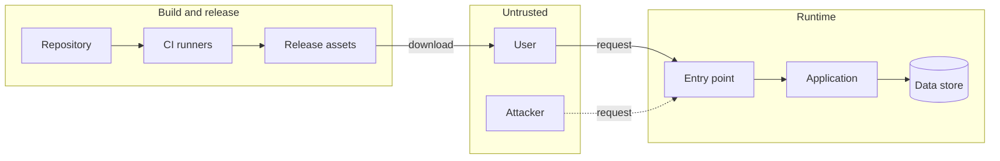

<!--
title: '🕵️ THREAT MODEL'
description: 'What this project protects, who could attack it and where, and the control that answers each threat, ending in what users can and cannot rely on. Fill it in before the first release, and review it on the cadence it sets and whenever the architecture changes.'
type: template
-->

# 🕵️ THREAT MODEL

**What this project protects, who could attack it, and what stops them.**

_Name the threat. Place the control. Own the gap._

---

> [!NOTE]
> **How to use**: copy this file to `docs/operations/Threat-Model.md`, the same path minus `templates/`, and replace every `[bracket]`. The seed here stays pristine. The controls this template already ships are filled in under **6. Mitigations**, so the work left is this project's own part: its assets, its boundaries, and the threats its own code adds.

---

## 🎯 Purpose & Intent

This is the project's security self-assessment and threat model: the most likely and most harmful things that could go wrong, where an attacker could reach the system, and what answers each threat. Filled in and kept current, it meets two controls of the [OpenSSF Baseline](https://baseline.openssf.org/), the security assessment (OSPS-SA-03.01) and the threat model with its attack surface analysis (OSPS-SA-03.02), and two criteria of the [OpenSSF Best Practices badge](https://www.bestpractices.dev/), the security requirements (`documentation_security`) and the assurance case (`assurance_case`).

- **Specific**: real assets, real entry points, real controls. A threat with no control is a gap, and this document shows it.
- **Honest**: a risk the project accepts is written down with a name and a date, never left out.
- **Current**: reviewed on a schedule and whenever the architecture changes, and every review is logged.

---

## 📦 1. Scope & Assets

- **In scope**: `[The released software | Its build and release pipeline | This repository | A service the project runs]`
- **Out of scope**: `[What this model does not cover, and who does: the hosting platform, a user's own deployment]`
- **Release covered**: `[vX.Y.Z]`

| Asset                                     | Why it matters                                 | Worst loss                                                     |
| :---------------------------------------- | :--------------------------------------------- | :------------------------------------------------------------- |
| **Source code and history**               | Every release is built from it                 | Integrity: a change nobody reviewed ships                      |
| **Release assets**                        | What users download and run                    | Integrity: a tampered file runs on users' machines             |
| **CI credentials and repository secrets** | Whoever holds them can publish as this project | Confidentiality: someone else releases in its name             |
| **[User data the project holds]**         | `[REPLACE_ME]`                                 | `[Confidentiality \| Integrity \| Availability]: [REPLACE_ME]` |
| **[The running service]**                 | `[REPLACE_ME]`                                 | `[Availability: REPLACE_ME]`                                   |

The first three hold for every project built from this template. Add the assets that are this project's own.

---

## 👥 2. Actors & Trust Levels

| Actor                      | Trust                          | Can                                                                                                | Cannot                                                                      |
| :------------------------- | :----------------------------- | :------------------------------------------------------------------------------------------------- | :-------------------------------------------------------------------------- |
| **Maintainers**            | High                           | Merge, publish releases, change settings and secrets                                               | `[What the rulesets stop even a maintainer doing, and who may bypass them]` |
| **Contributors**           | Low                            | Open pull requests, which CI runs                                                                  | Merge, or read secrets: a fork's pull request runs without them             |
| **Automation**             | Scoped                         | What each workflow job's `permissions:` grants it                                                  | Anything above that ceiling                                                 |
| **[Users]**                | `[None \| Signed in \| Admin]` | `[Use the released software as documented]`                                                        | `[REPLACE_ME]`                                                              |
| **Attackers**              | None                           | Anything public: open issues and pull requests, call public endpoints, publish look-alike packages | `[REPLACE_ME]`                                                              |
| **[Third-party services]** | `[REPLACE_ME]`                 | `[REPLACE_ME]`                                                                                     | `[REPLACE_ME]`                                                              |

---

## 🚧 3. Trust Boundaries & Data Flows

A trust boundary is anywhere data or control passes between parts trusted to different degrees. Every threat in section 5 sits on one of them. `[Replace the diagram with this project's own parts, one subgraph for each zone of trust.]`

| Flow   | From → To                    | Data                           | Crosses a boundary | Protected by                                 |
| :----- | :--------------------------- | :----------------------------- | :----------------- | :------------------------------------------- |
| **F1** | `[User → Entry point]`       | `[Requests, credentials]`      | Yes                | `[TLS; authentication; input validation]`    |
| **F2** | Repository → CI runners      | Source and workflow files      | Yes                | Pinned actions, scoped tokens, Harden-Runner |
| **F3** | CI runners → Release assets  | The build archive and its SBOM | Yes                | Build provenance attestation                 |
| **F4** | `[Application → Data store]` | `[REPLACE_ME]`                 | `[Yes \| No]`      | `[REPLACE_ME]`                               |

---

## 🚪 4. Entry Points & Attack Surface

Every way into the system, who can reach it, and what it accepts. Each row is where an attack would start.

| Entry point                                    | Reachable by                                      | Authentication         | Accepts                                     | Documented in                                                   |
| :--------------------------------------------- | :------------------------------------------------ | :--------------------- | :------------------------------------------ | :-------------------------------------------------------------- |
| `[Public API \| CLI \| Web UI \| Library API]` | `[Anyone \| Signed-in users]`                     | `[REPLACE_ME]`         | `[Requests, arguments, uploaded files]`     | `[REPLACE_ME]`                                                  |
| `[Configuration and environment]`              | `[Whoever deploys it]`                            | `[REPLACE_ME]`         | `[Settings and secrets]`                    | `[REPLACE_ME]`                                                  |
| Pull requests                                  | `[Anyone with a GitHub account \| Collaborators]` | GitHub account         | Code, including changes to workflows        | `.github/CONTRIBUTING.md`                                       |
| Issues and discussions                         | `[Anyone with a GitHub account \| Collaborators]` | GitHub account         | Text, links and attachments                 | `.github/SUPPORT.md`                                            |
| Dependencies                                   | Their maintainers                                 | Their registry account | Code that runs in the build and at run time | `[The dependency manifests]`                                    |
| Release assets                                 | Anyone, to download                               | None                   | Nothing: the risk is a swapped file         | [Release Verification](../distribution/Release-Verification.md) |

- **Critical code paths**: `[The functions that parse untrusted input, check permissions, or handle secrets or money: name each, and where it lives]`

---

## ⚔️ 5. Threats

Walk each boundary in section 3 through the six STRIDE categories, and add a row for every threat that applies. Rate likelihood and impact `[High | Medium | Low]`, and point each threat at what answers it in section 6.

| ID      | Boundary                      | STRIDE                 | Threat                                                                    | Likelihood     | Impact         | Answered by                            |
| :------ | :---------------------------- | :--------------------- | :------------------------------------------------------------------------ | :------------- | :------------- | :------------------------------------- |
| **T1**  | `[User → Entry point]`        | Spoofing               | `[Someone signs in as another user]`                                      | `[REPLACE_ME]` | `[REPLACE_ME]` | `[M1]`                                 |
| **T2**  | `[User → Entry point]`        | Tampering              | `[A request changes data its sender does not own]`                        | `[REPLACE_ME]` | `[REPLACE_ME]` | `[REPLACE_ME]`                         |
| **T3**  | `[Application]`               | Repudiation            | `[A user denies an action, and no log shows it]`                          | `[REPLACE_ME]` | `[REPLACE_ME]` | `[REPLACE_ME]`                         |
| **T4**  | `[Application → Data store]`  | Information disclosure | `[An error or a query returns another user's data]`                       | `[REPLACE_ME]` | `[REPLACE_ME]` | `[REPLACE_ME]`                         |
| **T5**  | `[User → Entry point]`        | Denial of service      | `[A flood of requests, or one expensive request, takes the service down]` | `[REPLACE_ME]` | `[REPLACE_ME]` | `[REPLACE_ME]`                         |
| **T6**  | `[Entry point → Application]` | Elevation of privilege | `[A user reaches an admin action]`                                        | `[REPLACE_ME]` | `[REPLACE_ME]` | `[M2]`                                 |
| **T7**  | Repository → CI runners       | Tampering              | A pull request changes a workflow to steal secrets or poison the build    | `[REPLACE_ME]` | High           | Workflow lint, scoped tokens, rulesets |
| **T8**  | CI runners → Release assets   | Tampering              | A release asset is swapped, or built from code nobody reviewed            | `[REPLACE_ME]` | High           | Provenance attestation, rulesets       |
| **T9**  | Repository                    | Information disclosure | A credential is committed                                                 | `[REPLACE_ME]` | High           | Secret scanning                        |
| **T10** | Dependencies → Build          | Tampering              | A dependency brings in a known vulnerability or malicious code            | `[REPLACE_ME]` | `[REPLACE_ME]` | Dependency review, SBOM                |

| STRIDE                     | Asks                                                    |
| :------------------------- | :------------------------------------------------------ |
| **Spoofing**               | Can someone pretend to be another user or system?       |
| **Tampering**              | Can someone change data or code they should not?        |
| **Repudiation**            | Can someone deny an action, with no record to prove it? |
| **Information disclosure** | Can someone read data they should not?                  |
| **Denial of service**      | Can someone stop others from using it?                  |
| **Elevation of privilege** | Can someone gain rights they were not given?            |

---

## 🛡️ 6. Mitigations

### Shipped With The Template

These run in every repository built from this template, through the workflow stubs in `.github/workflows/` that call the shared workflows in [tannergolden/standards](https://github.com/tannergolden/standards). Check the **Holds when** column against this project: several hold only on a public repository.

| Control                             | Answers                                                                                                                                     | Enforced in                                                                                                                                                         | Holds when                                                                                                                                                                                             |
| :---------------------------------- | :------------------------------------------------------------------------------------------------------------------------------------------ | :------------------------------------------------------------------------------------------------------------------------------------------------------------------ | :----------------------------------------------------------------------------------------------------------------------------------------------------------------------------------------------------- |
| **Secret scanning** (gitleaks)      | T9                                                                                                                                          | The `secrets` job in `.github/workflows/checks.yml`, a required check once the rulesets apply, and the local `pre-commit` hook                                      | Every pull request and every push to the default branch, plus a weekly scan of the full history                                                                                                        |
| **CodeQL**                          | Injection and other weaknesses in the code, and in the GitHub Actions workflows                                                             | The `codeql` job in `checks.yml`                                                                                                                                    | Public repositories. Languages are detected, so a new one is covered without a change. On a private repository the job skips; with GitHub Advanced Security, use GitHub's default CodeQL setup instead |
| **actionlint and zizmor**           | T7: broken or unsafe workflows, such as script injection, over-broad permissions and unpinned actions                                       | The `lint` job in `checks.yml`                                                                                                                                      | Every pull request and every push to the default branch                                                                                                                                                |
| **Dependency review**               | T10: a pull request that adds a dependency with a known vulnerability                                                                       | The dependency review in the `ci` job of `checks.yml`                                                                                                               | Pull requests on a public repository. It fails at `high` severity and above, and blocks the merge, a required check once the rulesets apply                                                            |
| **Harden-Runner**                   | A compromised build step calling out to an unknown host                                                                                     | The first step of the jobs in the shared workflows                                                                                                                  | Always, in audit mode: it records each outbound connection and blocks none                                                                                                                             |
| **Rulesets**                        | T7, T8: a direct push, force-push or deletion on `Development`, `Preview` or `Release`, a merge with failing checks, or a moved version tag | The rulesets in [Branch Protection](https://github.com/tannergolden/standards/blob/Development/docs/operations/Branch-Protection.md), written by 🎯 Apply Standards | Once applied: they ship switched off                                                                                                                                                                   |
| **Private vulnerability reporting** | A vulnerability made public before a fix exists                                                                                             | Repository settings, turned on by 🎯 Apply Standards or by hand under Settings → Advanced Security; `.github/SECURITY.md` sends reporters there                     | Public repositories. A private one takes reports through the Vulnerability Report issue form                                                                                                           |
| **Build provenance attestation**    | T8: a release asset that was swapped, or not built by this repository's release workflow                                                    | The `publish` task of 📦 Release, in `.github/workflows/release.yml`                                                                                                | Public repositories, for the build archive. A private repository needs GitHub Enterprise Cloud for attestations, and the shared workflow skips the step there                                          |
| **SBOM**                            | T10: not knowing whether a release contains a dependency later found vulnerable                                                             | The `publish` task of 📦 Release, attached to the release as `sbom-<tag>.cdx.json`                                                                                  | Every release. A tree with no manifests or lockfiles gets one that lists no components                                                                                                                 |

### This Project's Own

| ID     | Mitigation                                                      | Answers        | Enforced in                                                 | Status                                           |
| :----- | :-------------------------------------------------------------- | :------------- | :---------------------------------------------------------- | :----------------------------------------------- |
| **M1** | `[Rate limits and lockout on sign-in]`                          | `[T1, T5]`     | `[CI check \| Repository setting \| Code: path \| Process]` | `[In place \| Planned: #issue \| Accepted risk]` |
| **M2** | `[Authorization checked on every request, not only at sign-in]` | `[T6]`         | `[Code: src/app/REPLACE_ME]`                                | `[REPLACE_ME]`                                   |
| **M3** | `[REPLACE_ME]`                                                  | `[REPLACE_ME]` | `[REPLACE_ME]`                                              | `[REPLACE_ME]`                                   |

---

## 📜 7. Security Expectations

What a user of this project can rely on, and what they cannot. Write it for someone deciding whether to run this software.

**You can rely on:**

- [Each release asset can be traced to the commit and the workflow that built it, as [Release Verification](../distribution/Release-Verification.md) shows]
- [A vulnerability reported privately is acknowledged within the time `.github/SECURITY.md` gives]
- [Data sent to the service is encrypted in transit]
- [REPLACE_ME]

**You cannot rely on:**

- [Protection from someone who already has admin rights on your installation]
- [The security of a deployment that departs from the documented configuration]
- [Fixes for versions older than those `.github/SECURITY.md` lists as supported]
- [REPLACE_ME]

**Your part:** [Stay on a supported version; verify each download; run it with the least privilege it needs; keep your own credentials secret]

---

## ⚖️ 8. Assurance Case

Why the expectations above hold. The Best Practices badge asks for four parts: the threat model and the trust boundaries, which sections 3 to 5 already give, and two arguments, set out below: that the design follows secure design principles, and that common implementation weaknesses are countered.

| Secure design principle              | How this project applies it                                                                                                                              |
| :----------------------------------- | :------------------------------------------------------------------------------------------------------------------------------------------------------- |
| **Least privilege**                  | Every workflow starts from `permissions: {}`, and each job asks only for the scopes it uses. `[How the project's own accounts and services are limited]` |
| **Fail-safe defaults**               | `[Access is denied unless a rule allows it, at: REPLACE_ME]`                                                                                             |
| **Complete mediation**               | `[Every request is authorized at: layer, not only at sign-in]`                                                                                           |
| **Separation of privilege**          | A merge needs the required checks to pass, once the rulesets apply. `[What else a release needs: REPLACE_ME]`                                            |
| **Input validation at the boundary** | `[Untrusted input is validated in: layer, before the domain sees it]`                                                                                    |
| **Economy of mechanism**             | `[REPLACE_ME]`                                                                                                                                           |

| Common weakness                             | Countered by                                                   | Checked by            |
| :------------------------------------------ | :------------------------------------------------------------- | :-------------------- |
| **Injection** (CWE-89, CWE-78)              | `[Parameterized queries; no shell command built from input]`   | `[CodeQL; review]`    |
| **Cross-site scripting** (CWE-79)           | `[Output encoding in: REPLACE_ME]`                             | `[CodeQL]`            |
| **Missing authorization** (CWE-862)         | `[REPLACE_ME]`                                                 | `[Tests: REPLACE_ME]` |
| **Path traversal** (CWE-22)                 | `[REPLACE_ME]`                                                 | `[CodeQL]`            |
| **Hard-coded credentials** (CWE-798)        | Secrets come from the environment, never from the tree         | Secret scanning       |
| **Vulnerable dependencies**                 | Dependency review, the SBOM, and `[Dependabot for: ecosystem]` | Dependency review     |
| `[Others from: OWASP Top 10 \| CWE Top 25]` | `[REPLACE_ME]`                                                 | `[REPLACE_ME]`        |

---

## ⚠️ 9. Residual & Accepted Risks

A risk stays on this list until a mitigation closes it. A risk nobody accepted is a gap: give it a mitigation or an issue.

| Risk                                                       | Why it remains                                                                  | Accepted by | On             | Revisit         |
| :--------------------------------------------------------- | :------------------------------------------------------------------------------ | :---------- | :------------- | :-------------- |
| `[A maintainer account is taken over]`                     | `[Two-factor sign-in lowers the chance; a stolen session or token still works]` | `[@handle]` | `[YYYY-MM-DD]` | `[Next review]` |
| `[Harden-Runner records outbound traffic and blocks none]` | `[Blocking needs a list of every host the build reaches]`                       | `[@handle]` | `[YYYY-MM-DD]` | `[Next review]` |
| `[REPLACE_ME]`                                             | `[REPLACE_ME]`                                                                  | `[@handle]` | `[YYYY-MM-DD]` | `[REPLACE_ME]`  |

---

## 🔁 10. Review

- **Owner**: `[@handle]`
- **Cadence**: `[Every release | Every quarter | Every 6 months]`
- **Also review when**: a new entry point, data store, trust boundary or network-facing dependency lands, the [Architecture Overview](../technical/Architecture-Overview.md) changes, or a security incident or report arrives.

| Date           | Reviewer    | Release    | What changed                                       |
| :------------- | :---------- | :--------- | :------------------------------------------------- |
| `[YYYY-MM-DD]` | `[@handle]` | `[vX.Y.Z]` | `[First version \| No change \| Added T11 and M4]` |

### 🔗 See also

> [!TIP]
> Every canonical guide is indexed in the [&#x1F4DA; Standards Index](https://github.com/tannergolden/standards/blob/Development/docs/README.md). If you rename or move a file, update every reference to it across the repository to prevent link drift.

---

**A model kept as current as the code it defends.**

[↑ Back to Top](#top)

 

Built with ❤️ by the Engineering Team. Distributed under the terms in [LICENSE](/LICENSE).

