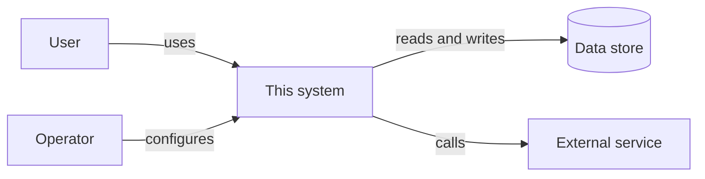

<!--
title: '🏛️ ARCHITECTURE OVERVIEW'
description: 'The living map of the system as it is built today: its context, actors and their actions, building blocks, external interfaces, data, trust boundaries, quality budgets and known limits. Keep it current with every release; a proposal for one change belongs in a Technical Design instead.'
type: template
-->

# 🏛️ ARCHITECTURE OVERVIEW

**The system as it is built today: its parts, its edges, and the reasons behind them.**

_Describe what is, not what was planned._

---

> [!NOTE]
> **How to use**: copy this file to `docs/technical/Architecture-Overview.md`, the same path minus `templates/`, and replace every `[bracket]`. The seed here stays pristine. This is the map of the whole system as it stands. A [Technical Design](../Technical-Design.md) proposes one change to it; once that change ships, update this document in the same pull request.

---

## 🎯 Our Architecture Intent

This document describes the system a newcomer, a reviewer or an auditor will actually find in the code. Filled in, it is the design documentation of the [OpenSSF Baseline](https://baseline.openssf.org/), with every actor and action (OSPS-SA-01.01) and every external interface (OSPS-SA-02.01), and the architecture reference of the [OpenSSF Best Practices badge](https://www.bestpractices.dev/) (`documentation_architecture`).

- **Current**: it changes in the same pull request as the code it describes.
- **Complete at the edges**: every actor, interface and data store is listed, the small ones too.
- **Linked, not repeated**: the detail lives in the other fill-in standards, the threat model and the ADRs, and this page points to it.

---

## 🧭 1. Purpose & Context

`[Two or three sentences: what the system does, for whom, and the one or two constraints that shaped it most.]`

`[Replace the diagram with this system's real neighbours: the people and systems around it, not its insides.]`

---

## 👥 2. Actors & Actions

Every person and system that acts on this one, and every action each can take. Use the same actor names as the [Threat Model](../operations/Threat-Model.md).

| Actor                  | Kind   | Actions                                                        | Through                       |
| :--------------------- | :----- | :------------------------------------------------------------- | :---------------------------- |
| **[End user]**         | Person | `[Sign in; create, read, change and delete their own records]` | `[Web UI \| CLI \| API]`      |
| **[Operator]**         | Person | `[Deploy; change configuration; restore a backup]`             | `[REPLACE_ME]`                |
| **[Scheduled job]**    | System | `[REPLACE_ME]`                                                 | `[REPLACE_ME]`                |
| **[External service]** | System | `[Sends webhooks]`                                             | `[REPLACE_ME]`                |
| **Maintainers**        | Person | Merge changes and publish releases                             | The repository and 📦 Release |

---

## 🧱 3. Building Blocks

The source is laid out in three layers whose dependencies point inward, as `src/README.md` describes and the [Source Code](Source-Code.md) standard sets the rules for.

| Layer              | Folder        | Holds in this system                                               |
| :----------------- | :------------ | :----------------------------------------------------------------- |
| **Domain**         | `src/domain/` | `[The entities and business rules: REPLACE_ME]`                    |
| **Application**    | `src/app/`    | `[The entry points and use cases: REPLACE_ME]`                     |
| **Infrastructure** | `src/infra/`  | `[The adapters: the database repository, the client for: service]` |

The containers are the parts that run or store data on their own. Each is built from components in those layers.

| Container               | Technology     | Responsibility | Built from                  |
| :---------------------- | :------------- | :------------- | :-------------------------- |
| **[Web application]**   | `[REPLACE_ME]` | `[REPLACE_ME]` | `[src/app/: entry point]`   |
| **[Background worker]** | `[REPLACE_ME]` | `[REPLACE_ME]` | `[src/app/: jobs]`          |
| **[Database]**          | `[REPLACE_ME]` | `[REPLACE_ME]` | `[src/infra/: its adapter]` |

---

## 🔌 4. External Interfaces

Every interface the released software offers or depends on, and where each is documented in full.

| Interface              | Direction                       | Protocol or format                                | Documented in                                                            |
| :--------------------- | :------------------------------ | :------------------------------------------------ | :----------------------------------------------------------------------- |
| **[Public API]**       | Inbound                         | `[REST \| GraphQL \| gRPC \| CLI \| Library API]` | [API Design Standards](backend/API-Design-Standards.md), `[schema file]` |
| **[Configuration]**    | Inbound                         | `[Environment variables \| Config file]`          | `.env.example`, `[REPLACE_ME]`                                           |
| **[File formats]**     | `[Inbound \| Outbound \| Both]` | `[REPLACE_ME]`                                    | `[REPLACE_ME]`                                                           |
| **[External service]** | Outbound                        | `[REPLACE_ME]`                                    | `[REPLACE_ME]`                                                           |

---

## 💾 5. Data Flow & Storage

The main flow, from a request arriving to a response leaving:

1. `[A request arrives at: entry point]`
2. `[The application layer validates it and calls: use case]`
3. `[The domain applies: rule]`
4. `[The infrastructure layer reads or writes: store]`
5. `[A response, an event or a file goes to: REPLACE_ME]`

| Store                  | Holds          | Sensitivity                                  | Retention      | Backed up      |
| :--------------------- | :------------- | :------------------------------------------- | :------------- | :------------- |
| **[Primary database]** | `[REPLACE_ME]` | `[Public \| Internal \| Personal \| Secret]` | `[REPLACE_ME]` | `[REPLACE_ME]` |
| **[Cache or queue]**   | `[REPLACE_ME]` | `[REPLACE_ME]`                               | `[REPLACE_ME]` | `[REPLACE_ME]` |

The entities themselves are described in [Data Models & Entities](database/Data-Models-&-Entities.md).

---

## 🚧 6. Trust Boundaries

Where data or control passes between parts trusted to different degrees. Each boundary is drawn, and its threats worked through, in the [Threat Model](../operations/Threat-Model.md).

| Boundary                      | Crossed by                   | Checked by                                                     |
| :---------------------------- | :--------------------------- | :------------------------------------------------------------- |
| `[Internet → entry point]`    | `[Requests from users]`      | `[Authentication and input validation in: src/app/REPLACE_ME]` |
| `[Application → data store]`  | `[Queries]`                  | `[A database account with only the rights it needs]`           |
| `[System → external service]` | `[Outbound calls, webhooks]` | `[Signed webhooks; timeouts; REPLACE_ME]`                      |

---

## ⚡ 7. Quality Attributes

The qualities this architecture is built to keep, each with a budget it is measured against. The performance budgets, and how they are measured, are kept in [Performance Benchmarks](benchmarks/Performance-Benchmarks.md).

| Attribute          | Budget                                                    | Measured by                               |
| :----------------- | :-------------------------------------------------------- | :---------------------------------------- |
| **Performance**    | `[p95 latency under N ms]`                                | Performance Benchmarks                    |
| **Availability**   | `[99.9% a month]`                                         | `[Uptime monitor]`                        |
| **Scalability**    | `[N concurrent users, or N requests a second]`            | `[Load test]`                             |
| **Recoverability** | `[At most N minutes of data lost; back within N minutes]` | `[Restore drill]`                         |
| **Security**       | The expectations in the Threat Model                      | The checks in CI, and the reviews it logs |
| **[REPLACE_ME]**   | `[REPLACE_ME]`                                            | `[REPLACE_ME]`                            |

---

## 📄 8. Key Decisions

The decisions that shaped this architecture. Each is recorded in full as an ADR, listed in the [ADR index](../../adrs/README.md).

| Decision                                      | Why, in one line | Record       |
| :-------------------------------------------- | :--------------- | :----------- |
| `[Chose: database, for: reason]`              | `[REPLACE_ME]`   | `[ADR-NNNN]` |
| `[Split the worker from the web application]` | `[REPLACE_ME]`   | `[ADR-NNNN]` |

---

## ⚠️ 9. Known Limitations

What the architecture does not do well today, and what that means for the people who use it.

- **[Limitation]**: `[What it means for users, and the issue, plan or ADR that deals with it]`
- **[Single region]**: `[An outage in that region takes the whole system down; accepted in ADR-NNNN]`

### 🔗 See also

> [!TIP]
> Every canonical guide is indexed in the [&#x1F4DA; Standards Index](https://github.com/tannergolden/standards/blob/Development/docs/README.md). If you rename or move a file, update every reference to it across the repository to prevent link drift.

---

**One map of the system, kept as true as the code.**

[↑ Back to Top](#top)

 

Built with ❤️ by the Engineering Team. Distributed under the terms in [LICENSE](/LICENSE).

